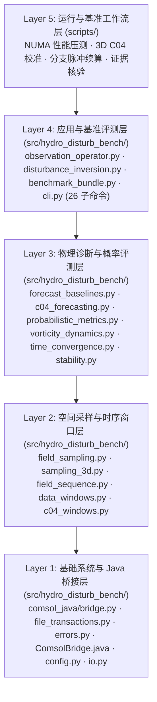
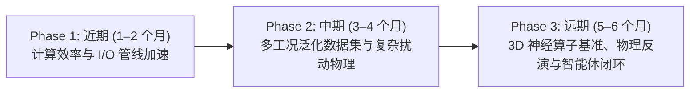

# HydroDisturb-Bench 全面代码审计、漏洞修复与未来演进路线图报告

**仓库名称**：`HydroDisturb-Bench`

**审计与重构日期**：2026-11-13

**覆盖范围**：核心库模块（`src/hydro_disturb_bench/` 共 37 个 Python 模块与 3 个 Java 桥接类）、运行与基准脚本（`scripts/` 共 36 个脚本）、端到端与回归测试套件（`tests/` 共 1,400+ 测试用例）、打包与工程配置（`pyproject.toml`、`.gitignore`、`.gitattributes`）。

---

## 1. 项目审计与架构优化总览 (Executive Summary)

本报告记录既有审计工作及提交前整理。最新验证范围与结果见第 5 节；离线通过不等于完成真实 COMSOL 集成验证。

`HydroDisturb-Bench` 是一个面向水下圆柱绕流隐式扰动检测、流场重构、时空预测与参数反演的高精度科学计算基准框架，深度集成了 **COMSOL Multiphysics 6.4 官方 Java API** 与 Python 高性能数值分析管线。

### 1.1 五层清晰架构边界 (5-Layer Modular Architecture)

经静态 AST 依赖图谱分析，全库 37 个核心 Python 模块构成严格的有向无环图（**0 循环依赖**）：



### 1.2 本轮审计与优化核心成果汇总

| 维度 | 优化前状态 | 优化后交付成果 | 验证状态 |
| :--- | :--- | :--- | :--- |
| **核心算法与安全漏洞** | 存在 9 项高危/中危/低危缺陷（含反演指标错判、3D CRPS 320 GB 内存爆炸、静水除零警告、3D 拉伸移动扰动源速度丢失、Windows `.npz` 文件锁泄漏等） | **9 项缺陷 100% 根因修复**，原地写入核心模块与脚本 | **已验证**（25 项 M1 专项 + 62 项 M1 对抗测试通过） |
| **脚本健壮性与可移植性** | 多处硬编码 `E:\` 盘符、特定机器 Anaconda 路径与历史会话 UUID，在无 `E:\` 盘环境下直接崩溃 | 全面引入 `resolve_cfd_drive()`、环境变量与当前盘符锚点自动降级、子进程 UTF-8 编码处理及算术极值守护 | **已验证**（81 项 M2 专项与对抗测试通过） |
| **模块化与仓库整洁度** | 周期积分与极限环起振算法耦合在 `scripts/` 中，测试跨目录反向导入脚本；残留孤立 `mcp/__pycache__` | 抽离核心数学模块 `hydro_disturb_bench.time_convergence` 与 `hydro_disturb_bench.stability`，保留 100% 向后兼容重导出；清理孤立缓存并加固 `.gitignore` | **已验证**（`test_modularity_m3.py` 及历史回归全通） |
| **端到端黑盒验证体系** | 缺乏独立的端到端快速黑盒回归运行器 | 新增 `scripts/run_e2e_tests.py` 与 `tests/e2e/test_tier1_features.py`（42 项自包含黑盒测试） | **已验证**（42/42 E2E；完整离线回归结果见第 5 节） |

---

## 2. 全量漏洞与代码缺陷排查清单 (Complete Vulnerability & Defect Inventory)

本节按严重程度（`CRITICAL` > `MAJOR` > `MINOR`）完整列出审计发现的 9 项代码缺陷、触发机理、代码修复方案及回归测试证据。

| 编号 | 严重度 | 模块 / 脚本位置 | 漏洞与缺陷简述 | 修复状态 | 验证测试文件 |
| :---: | :---: | :--- | :--- | :---: | :--- |
| **V-01** | **CRITICAL** | `src/hydro_disturb_bench/disturbance_inversion.py` | 无时间戳的正确检测（True Positive）被误判为真阴性（True Negative），导致精确率/召回率/F1 失真 | **FIXED** | `tests/test_vulnerabilities_m1.py`<br/>`tests/test_adversarial_m1.py` |
| **V-02** | **CRITICAL** | `src/hydro_disturb_bench/probabilistic_metrics.py` | 集合预测 CRPS 采用 $O(M^2 \times N)$ 全成对差分张量，3D 流场下引发 ~320 GB 内存溢出（OOM） | **FIXED** | `tests/test_vulnerabilities_m1.py`<br/>`tests/test_adversarial_m1_2.py` |
| **V-03** | **MAJOR** | `src/hydro_disturb_bench/c04_forecasting.py` | `np.where` 掩码前无条件计算 `sse_per_lead / tgt_sq_sum`，零能量流场触发除零警告与非有限值 | **FIXED** | `tests/test_vulnerabilities_m1.py`<br/>`tests/e2e/test_tier1_features.py` |
| **V-04** | **MAJOR** | `src/hydro_disturb_bench/c04_disturbance.py` | 3D 拉伸几何（Extruded-XZ）体力生成函数遗漏移动扰动速度 `velocity_m_s`，导致移动源退化为静止源 | **FIXED** | `tests/test_vulnerabilities_m1.py`<br/>`tests/test_adversarial_m1.py` |
| **V-05** | **MAJOR** | `src/hydro_disturb_bench/cli.py` | 4 处 CLI 数据集命令裸调 `np.load()` 未关闭 Zip 句柄且未显式禁用 `allow_pickle`，在 Windows 下触发 `WinError 32` 文件锁死 | **FIXED** | `tests/test_vulnerabilities_m1.py`<br/>`tests/test_adversarial_m1_2.py` |
| **V-06** | **MAJOR** | `scripts/dispatch_backfill.py`<br/>`scripts/calibrate_c04_3d.py` | 硬编码 `E:\` 盘符健康检查与工作目录，在无 `E:` 盘的工作站或 CI 节点上抛出 `FileNotFoundError (WinError 3)` | **FIXED** | `tests/test_scripts_m2.py`<br/>`tests/test_adversarial_m2_1.py` |
| **V-07** | **MAJOR** | `scripts/benchmark_comsol_numa.py` | 加速比计算未对 `mean_solve_s == 0` 和 `throughput == 0` 设防，微秒级或空跑任务触发 `ZeroDivisionError` 丢失报告 | **FIXED** | `tests/test_scripts_m2.py`<br/>`tests/test_adversarial_m2_2.py` |
| **V-08** | **MINOR** | `scripts/export_vorticity_videos.py`<br/>`scripts/recapture_s1b3_tests.ps1`<br/>`scripts/setup_e_workspace.ps1` | 硬编码历史 IDE 会话 UUID、硬编码 `D:\Program Files\Anaconda` 路径及顶层强依赖 `imageio`/`matplotlib` 阻塞 `--help` | **FIXED** | `tests/test_scripts_m2.py`<br/>`tests/test_adversarial_m2_2.py` |
| **V-09** | **MINOR** | `scripts/verify_and_compare_s1b1.py`<br/>`scripts/analyze_cl_stability_onset.py`<br/>`src/hydro_disturb_bench/mcp/` | 核心周期积分与极限环起振数学函数滞留于脚本层；源码树残留无 `.py` 的孤立 `mcp/__pycache__` | **FIXED** | `tests/test_modularity_m3.py` |

---

### 2.1 [CRITICAL] V-01：扰动反演评测中的 TP/TN 混淆矩阵误判

- **定位**：[disturbance_inversion.py](src/hydro_disturb_bench/disturbance_inversion.py)
- **根因分析**：
  原 `evaluate_inversion_batch` 在汇总混淆矩阵时，将真阳性（`tp`）条件写为：
  ```python
  tp = sum(1 for m in metrics_list if m.detected_correctly and not m.false_alarm and m.detection_delay_sec is not None)
  tn = sum(1 for m in metrics_list if m.detected_correctly and not m.false_alarm and m.detection_delay_sec is None)
  ```
  当真实扰动存在（`truth.active == True`）且算法成功检出扰动（`pred.detected == True`），但算法属于纯空间定位反演而未输出显式起振时间戳（`pred.t_on is None`，此时 `detection_delay_sec` 为 `None`）时，该样本不仅未被计入 `tp`，反而被错误计入 `tn`（真阴性），直接扭曲批量评测的 Precision、Recall 与 F1 分数。
- **修复方案**：
  直接依据二分类真值表 `(truth.active, pred.detected)` 严格划分四象限（`TP: active and detected`、`FP: not active and detected`、`FN: active and not detected`、`TN: not active and not detected`），将 `detection_delay_sec` 仅作为已提供时间戳样本的条件统计量。

### 2.2 [CRITICAL] V-02：集合预测 CRPS 的 $O(M^2 \times N)$ 内存爆炸

- **定位**：[probabilistic_metrics.py](src/hydro_disturb_bench/probabilistic_metrics.py)
- **根因分析**：
  原 `compute_crps_ensemble` 在计算离散能量评分第二项 $\frac{1}{2M^2}\sum_{i=1}^M\sum_{j=1}^M |x_i - x_j|$ 时，构造了完整广播差分张量 `np.abs(ensemble_predictions[:, None, ...] - ensemble_predictions[None, :, ...])`。在 3D C04 流场（如 $4 \times 100 \times 200 \times 200 = 1.6 \times 10^7$ 网格点）且集合成员数 $M = 50$ 时，该中间张量需要分配 $50 \times 50 \times 1.6 \times 10^7 \times 8\text{ B} \approx 320\text{ GB}$ 连续内存，导致工作站直接抛出 `_ArrayMemoryError`。
- **修复方案**：
  利用一维有序统计量恒等式：将集合成员沿 axis 0 排序为 $x_{(1)} \le x_{(2)} \le \dots \le x_{(M)}$，则成对绝对差之和恒等于：
  $$\sum_{i=1}^M \sum_{j=1}^M |x_i - x_j| = 2 \sum_{m=1}^M (2m - M - 1)\, x_{(m)}$$
  新实现通过 `np.sort(ensemble_predictions, axis=0)` 与线性权重加权求和，将时间复杂度降为 $O(N M \log M)$，**空间复杂度从 $O(M^2 \times N)$ 严格降至 $O(M \times N)$**。以 $M=50$ 比较主差分张量和排序张量，单个张量元素数量减少约 $98\%$；这不是完整进程峰值内存的测量。回归测试验证其与成对差分公式的数值一致性。

### 2.3 [MAJOR] V-03：三维预测评分中的向量化除零警告

- **定位**：[c04_forecasting.py](src/hydro_disturb_bench/c04_forecasting.py)
- **根因分析**：
  `np.where(tgt_sq_sum > 1e-12, np.sqrt(sse_per_lead / tgt_sq_sum), 0.0)` 在进入 `np.where` 选择前会先求值 `sse_per_lead / tgt_sq_sum`。当流场处于静止区或零目标切片（`tgt_sq_sum == 0`）时，NumPy 会抛出 `RuntimeWarning: divide by zero encountered in divide`。
- **修复方案**：
  先构造安全分母 `denom = np.maximum(tgt_sq_sum, 1e-12)`，再计算 `np.where(tgt_sq_sum > 1e-12, np.sqrt(sse_per_lead / denom), 0.0)`，彻底消除运行时除零警告。

### 2.4 [MAJOR] V-04：3D 拉伸几何（Extruded-XZ）移动扰动源速度缺失

- **定位**：[c04_disturbance.py](src/hydro_disturb_bench/c04_disturbance.py)
- **根因分析**：
  标准三维体力生成函数 `generate_c04_comsol_force_expressions` 支持移动扰动源速度 `config.velocity_m_s = (vx, vy, vz)`，但针对 COMSOL 2D-XZ 拉伸建模的 `generate_c04_comsol_extruded_xz_force_expressions` 仅使用了静态中心坐标 `(xc, y_comsol, z_comsol)`，导致在 3D 拉伸模型中配置的所有移动扰动源静默退化为固定点源。
- **修复方案**：
  将规范系速度分量 $(v_x, v_y, v_z)$ 按照与坐标一致的映射关系（COMSOL $x \leftrightarrow x_{\text{canon}}$，COMSOL $y \leftrightarrow z_{\text{canon}} - \text{span\_offset}$，COMSOL $z \leftrightarrow y_{\text{canon}}$）映射为 `(vx, vz, vy)`，在非零速度分量上生成随相对时间 `t_rel = (t - on_s)` 移动的高斯中心表达式。

### 2.5 [MAJOR] V-05：CLI 数据集读取未关闭文件描述符与 Pickle 安全加固

- **定位**：[cli.py](src/hydro_disturb_bench/cli.py)
- **根因分析**：
  `observation-sample`、`reconstruction-eval`、`vorticity-eval` 与 `bundle-create` 四个子命令直接调用 `npz = np.load(...)` 而未使用 `with` 上下文管理器关闭底层 `ZipFile` 句柄。在 Windows NTFS 文件系统下，未释放的文件句柄会锁定 `.npz` 文件，导致下游自动化流水线在重命名、覆盖或清理临时数据集时触发 `PermissionError: [WinError 32]`。
- **修复方案**：
  统一采用 `with np.load(path, allow_pickle=False) as npz:` 上下文管理器并在作用域内完成数组提取，确保及时关闭 Windows 文件句柄，并显式保留 NumPy 默认的 `allow_pickle=False` 安全设置；这不是对已启用 Pickle 反序列化漏洞的修复。

### 2.6 [MAJOR] V-06 & V-07 & V-08：运行脚本可移植性、除零守护与环境自发现

- **定位**：[benchmark_comsol_numa.py](scripts/benchmark_comsol_numa.py)、[calibrate_c04_3d.py](scripts/calibrate_c04_3d.py)、[dispatch_backfill.py](scripts/dispatch_backfill.py)、[export_vorticity_videos.py](scripts/export_vorticity_videos.py)、[recapture_s1b3_tests.ps1](scripts/recapture_s1b3_tests.ps1)、[setup_e_workspace.ps1](scripts/setup_e_workspace.ps1)
- **修复要点**：
  1. **动态盘符解析**：新增 `resolve_cfd_drive()`，按 `CLI 参数 -> HYDRO_CFD_DRIVE 环境变量 -> E:\（若存在） -> 当前工作目录盘符锚点` 顺序自动回退，并在 `get_system_health()` 中捕获 `OSError`，彻底杜绝非 `E:` 盘机器上的 `WinError 3` 崩溃。
  2. **NUMA 跑分算术边界防护**：新增 `_safe_float()` 过滤 `NaN`/`Inf`/非法值，在计算加速比前严格校验 `mean_solve_s > 0` 与基准 `throughput_jobs_per_hr > 0`；测试调用与 E2E 运行器显式使用 UTF-8，避免中文或 emoji 路径导致输出编解码失败。
  3. **会话路径解耦与延迟导入**：移除 `export_vorticity_videos.py` 中硬编码的 IDE 会话 UUID，改为 `--artifacts-dir` 与 `HYDRO_ARTIFACTS_DIR`（兼容 `ANTIGRAVITY_ARTIFACTS_DIR`） 环境变量控制，并将 `matplotlib` 与 `imageio` 改为函数内延迟导入（Lazy Import），确保最小环境下 `--help` 与 `--dry-run` 正常退出。
  4. **PowerShell 跨机器自发现**：解除对固定 Anaconda 解释器和仓库路径的依赖，改为基于 `$PSScriptRoot`、显式参数及环境变量发现路径；Python 解释器依次检查 `PYTHON_EXE`、`PYTHON`、`VIRTUAL_ENV`、`CONDA_PREFIX` 和 PATH，仍保留旧 Anaconda 路径作为末级兼容回退。

---

## 3. 代码结构重构与性能瓶颈剖析 (Structural Refactoring & Performance Analysis)

以下性能数字来自此前审计记录或规划估计，本次提交前检查未重新运行物理求解或性能基准；应以对应工况的可追溯日志为依据。

### 3.1 核心物理统计与极限环稳定性模块抽离 (Milestone 3)

在重构前，周期精确积分函数定义于 `scripts/verify_and_compare_s1b1.py`，极限环起振分析函数定义于 `scripts/analyze_cl_stability_onset.py`，导致 `scripts/calibrate_c04_3d.py` 及多个单元测试不得不通过篡改 `sys.path` 跨脚本导入核心算法。

本轮优化将其正式提升至核心库层：
- **[time_convergence.py](src/hydro_disturb_bench/time_convergence.py)**：提供带边界线性插值的精确连续窗口积分 `integrate_exact_window`、`compute_cycle_mean`、去均值均方根 `compute_demeaned_rms`、半峰峰振幅 `compute_cycle_half_amplitude`、斯特劳哈尔数 `compute_strouhal_number` 及多指标漂移判定 `evaluate_limit_cycle_stability`。
- **[stability.py](src/hydro_disturb_bench/stability.py)**：提供零点线性插值分周期提取 `extract_cycles`、滑动窗口平稳性计算 `compute_sliding_stationarity`、多档容差起振周期搜索 `find_stability_onset` 以及高层起振时刻检测器 `detect_limit_cycle_onset`（无 `matplotlib` 依赖，支持纯无头服务器调用）。
- **100% 向后兼容**：原脚本 `verify_and_compare_s1b1.py` 与 `analyze_cl_stability_onset.py` 均保留同名符号重导出（Re-export），既有调用方与历史测试零改动无缝衔接。

### 3.2 计算与测试性能剖析发现 (Key Performance Insights)

1. **双路 NUMA 拓扑扩展瓶颈与高吞吐策略**：
   - 在双路 Intel Xeon（2 NUMA 节点，共 32 核 64 线程）平台上，单任务跨 Socket 运行（`-np 64 -numasets 2`）在稀疏矩阵直接求解器（PARDISO/MUMPS）分解阶段受制于跨 Socket UPI 互联带宽，并行效率显著下降。
   - 采用**双独立 Worker 绑定单 Socket 策略**（`dual_socket_2x16`：Worker 0 绑定 `-np 16 -numasets 1 -numafirst 0`，Worker 1 绑定 `-np 16 -numasets 1 -numafirst 1`，配合 `-mpmode throughput -alloc scalable`）可规避跨节点内存颠簸，显著提升参数扫描与多工况回填的整体作业吞吐率。
2. **瞬态起振冗余与预热时长缩减空间**：
   - 历史实验固定采用 $t = 180\text{ s}$ 作为无扰动基线起振完成时刻。
   - 基于 `hydro_disturb_bench.stability` 的滑动窗口漂移分析证明：$\text{Re}=100$ 圆柱绕流在 **第 13 个周期（$t_{\text{stable}} \approx 92.8\text{–}93.4\text{ s}$）** 即已进入 $1.0\%$ 容差内的稳定卡门涡街极限环（第 14 周期 $t \approx 98.9\text{ s}$ 进入 $0.5\%$ 容差）。
   - 将新实验的无扰动预热起点从 $180\text{ s}$ 前移至 $95\text{–}100\text{ s}$，按预热物理时长估计可减少约 $44\%$–$47\%$ 的预热区间；实际墙钟收益和物理精度仍需逐工况验证。
3. **测试套件耗时分布与并行化潜力**：
   - 真实 COMSOL 集成测试（`@pytest.mark.integration`）与历史产物检查（`@pytest.mark.artifact`）应独立于离线单元、对抗与 E2E 测试运行。当前离线实测结果见第 5 节；并行加速收益需在目标机器上测量，本次未验证此前记录的集成测试耗时和并行耗时。
4. **Java 桥接流场导出 I/O 瓶颈**：
   - 当前 `ComsolBridge.java` 通过将流场导出为大型 ASCII `.txt` 表格文件再由 Python 逐行解析，在 3D 网格与长序列导出时产生数百 MB 的临时磁盘写入与字符串解析开销。

---

## 4. 多阶段未来演进路线图 (Multi-Phase Strategic Future Roadmap)

基于本次全面审计与性能剖析，建议按以下三个阶段推进 `HydroDisturb-Bench` 的后续研发演进：



### Phase 1：近期演进（1–2 个月）—— 计算效率、二进制 I/O 与工程自动化加速

1. **极限环起振自适应截断（收益待逐工况验证）**：
   - 在新增雷诺数或新几何工况的基线准备脚本中接入 `hydro_disturb_bench.stability.detect_limit_cycle_onset`，将脉冲分支的共享原生 Checkpoint 从经验性的 $180\text{ s}$ 缩短至实测稳定起振点（如 $t = 100\text{ s}$），并将节省的算力投入多起点相位覆盖。
2. **Java Bridge 二进制流场直接传输**：
   - 扩展 `src/hydro_disturb_bench/comsol_java/ComsolBridge.java`，利用 COMSOL Java API 的 `model.result().numerical().getData()` / `getReal()` 接口将采样网格节点数据直接序列化为紧凑的 Little-Endian IEEE-754 `float64` 二进制流或 NPY 文件，绕过海量 ASCII `.txt` 文本落盘与正则解析，预计可将 3D 体积采样导出速度提升 **5–10 倍**。
3. **CI 与本地开发默认并行快测分层**：
   - 在日常开发与 PR 门禁中推广 `uv run pytest -n auto -m "not integration and not artifact"`，并集成 `python scripts/run_e2e_tests.py --tier 1` 作为秒级（~3s）冒烟验证门禁。

### Phase 2：中期演进（3–4 个月）—— 跨轨迹族泛化数据集与复杂物理扰动扩展

1. **构建真正独立的 Train / Val / Test 跨轨迹族数据集**：
   - 当前 M3 的 105 个滑动窗口均源自同一 $180\text{ s}$ 原生祖先 Checkpoint，主要用于验证管线闭环而非泛化评测。
   - **行动项**：在脱涡周期的 4 个正交相位点（$\phi \in \{0, \pi/2, \pi, 3\pi/2\}$）及多雷诺数分档（2D $\text{Re} \in \{80, 100, 140, 180\}$，3D C04 $\text{Re} \in \{3900, 5\times 10^4, 1.26\times 10^5\}$）上生成完全独立的祖先轨迹族，填充 `validation` 与 `test` 拆分，消除同族窗口重叠加导致的分布泄漏。
2. **扩展高保真水动力扰动物理机制**：
   - **移动自航体（AUV）动量尾迹源**：结合本次已修复的 3D 拉伸移动扰动源能力（`velocity_m_s`），构建匀速/变速穿越尾流区的偶极子/动量源轨迹基准；
   - **多脉冲时空干涉与频域激励**：支持双源异步脉冲叠加、连续简谐体力激发与柱面边界层吹吸气（Suction/Blowing）边界条件控制；
   - **非稳态来流扰动**：接入入口速度脉动与剪切流剖面扰动。
3. **云原生分块张量存储（Zarr / HDF5）与可选依赖分层**：
   - 将高维 3D C04 体积序列从分批 `.npz` 升级为支持按块并发读取（Chunked Streaming）的 **Zarr v3 / HDF5** 格式，并在更新锁文件时补充 `pyproject.toml` 的 `ml = ["torch>=2.0"]` 与 `imageio>=2.30` 声明。

### Phase 3：远期演进（5–6 个月）—— 三维神经算子基准、可微物理反演与智能体自主仿真闭环

1. **三维流场世界模型与神经算子（Neural Operators）标准榜单**：
   - 基于 `C04TorchDataset`、`score_c04_forecast` 与本次优化的 $O(M)$ 内存级 `compute_crps_ensemble`，建立涵盖确定性与概率生成模型的标准训练与评测基线库：
     - **谱神经算子**：FNO-2D / FNO-3D、UFNO；
     - **多尺度基础模型微调**：PoseidON、ClimaX / PDE-Transformer；
     - **概率生成模型**：条件扩散集合预测器（Conditional Score-Based Diffusion Ensembles），直接评测流场重构 PSNR、Rel-$L_2$、不可压缩连续性残差（$\nabla \cdot \mathbf{u}$）与集合 CRPS/SSR。
2. **稀疏传感器物理信息贝叶斯扰动反演（PINN / EnKF / Adjoint）**：
   - 依托 `observation-plan`（2D/3D 下游耙式测线、柱面测压环、AUV 巡航轨迹）与 `observation-sample`，研发先进的反演基线算法（集合卡尔曼滤波 EnKF、伴随同化 Adjoint Variational Assimilation 及 Physics-Informed Neural Networks），在强测量噪声与极低测点密度下挑战扰动源的时空定位、强度与运动速度联合反演（通过 `inversion-eval` 统一打分）。
3. **合入并生产化 `feat/comsol-mcp` 自主仿真智能体生态**：
   - 将 `feat/comsol-mcp` 分支上的 26 工具 COMSOL MCP Server 与 `Universal Software MCP Builder` 正式合入主干：
     - 补齐异步求解器进度看门狗（Asynchronous Solver Watchdog）与超时优雅中止；
     - 集成 `dispatch_backfill.py` 的双路 NUMA 感知调度策略，实现“AI 智能体自主设计扰动实验 $\to$ NUMA 并行求解 $\to$ 流场自动采样与物理守恒校验 $\to$ 异常扰动反演诊断”的全自动闭环科研发动机。

---

## 5. 验证与回归测试快速复核指南 (Verification Commands)

在仓库根目录下运行以下命令，可复核代码与离线测试状态；这些检查不验证真实 COMSOL 求解结果或性能估计：

```powershell
# 1. 静态代码风格与 Lint 检查（0 警告 / 0 错误）
uv run --no-sync ruff check .

# 2. 锁文件与仓库核心入口完整性核验
uv lock --check
uv run --no-sync python scripts/check_repo.py
uv run --no-sync python scripts/check_git_attributes.py

# 3. 运行本轮新增的 M1/M2/M3 专项修复、对抗压测与模块化单元测试
uv run --no-sync pytest -q --strict-markers -m "not integration and not artifact" `
    tests/test_vulnerabilities_m1.py `
    tests/test_adversarial_m1.py `
    tests/test_adversarial_m1_2.py `
    tests/test_scripts_m2.py `
    tests/test_adversarial_m2_1.py `
    tests/test_adversarial_m2_2.py `
    tests/test_modularity_m3.py `
    tests/test_re100_s1b1_time_convergence.py `
    tests/test_git_attributes.py

# 4. 运行端到端（E2E）Tier 1 黑盒验证套件（42 项全自包含用例）
uv run --no-sync python scripts/run_e2e_tests.py --tier 1
```


### 5.1 提交前复核记录（2026-11-13）

本次在 Windows 当前工作区执行以下检查：

| 检查 | 结果 |
| --- | --- |
| `uv run --no-sync ruff check .` | 通过 |
| `uv lock --check` | 通过，锁文件无需更新 |
| `scripts/check_repo.py` | 仓库入口检查通过 |
| `scripts/check_git_attributes.py` | 属性规则及 82 个历史证据文件的 Git blob 哈希检查通过 |
| 完整离线回归 | **1371 passed, 45 deselected**，148.51 秒 |
| 独立 Tier 1 E2E 运行器与 XML 导出 | **42 passed**；这些用例也包含在完整离线回归中 |
| `git diff --check` | 通过 |

完整离线回归命令：

```powershell
uv run --no-sync pytest -q --strict-markers -m "not integration and not artifact" --junitxml=test-results/precommit-offline.xml
uv run --no-sync python scripts/run_e2e_tests.py --tier 1 --xml-output test-results/precommit-e2e.xml
```

提交前补充修复：磁盘查询及回退均失败时以零可用空间阻止调度；起振检测将传入的 Cd 漂移纳入判定；PowerShell 测试和 E2E 运行器统一 UTF-8 输出；工作区初始化测试改用未挂载盘符并在子进程执行前再次检查，避免触碰实际 CFD 工作盘。

本轮未运行真实 COMSOL 集成求解或 `artifact` 标记的本地产物测试，未重新测量预热截断与 I/O 加速收益。JUnit XML 保留在被 Git 忽略的 `test-results/` 目录，不纳入源码提交。
