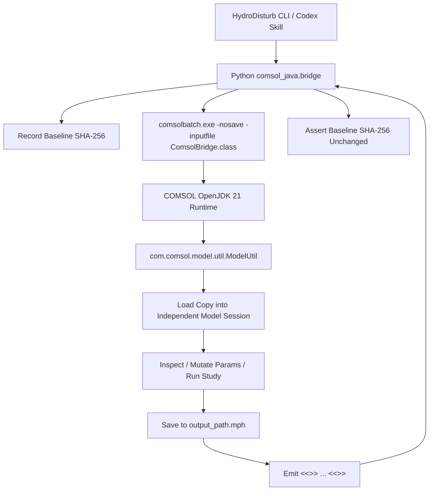

# COMSOL Java API Integration Architecture

This document describes the design, implementation, and safety mechanisms for connecting HydroDisturb-Bench with COMSOL Multiphysics 6.4 via the official Java API.

## 1. Technical Rationale & Architecture

HydroDisturb-Bench requires direct, programmatic, and deterministic control over 2D cylinder CFD simulation models. Rather than relying on untyped COM automation or third-party wrappers with undocumented state handling, this project interfaces directly with the official COMSOL Java API via `comsolbatch` and `comsolcompile`.

## 2. Environment Verification

The local installation was confirmed via Windows Registry `HKLM:\SOFTWARE\COMSOL\COMSOL64\COMSOLROOT`:
- **COMSOL Root**: `D:\Program Files\COMSOL64\Multiphysics`
- **COMSOL Version**: 6.4.0.429 (Win64)
- **Java Runtime**: OpenJDK 21.0.11 LTS (`java\win64\jre\bin\java.exe` & `javac.exe`)
- **Native Toolchain**:
  - `bin\win64\comsolcompile.exe`
  - `bin\win64\comsolbatch.exe`
  - `bin\win64\comsolmphserver.exe`
- **Official Documentation**:
  - `COMSOL Programming Reference Manual` (`doc\pdf\COMSOL_Multiphysics\COMSOL_ProgrammingReferenceManual.pdf`)
    - Chapter 1: Java API Overview & Standalone Execution
    - Chapter 2: `ModelUtil`, `ModelNode`, `Parameters`, `Study`, `Solver`

## 3. Strict Safety Contracts

### 3.1 Baseline Model Immutability
The baseline CFD model (e.g., `case/cylinder_flow.mph`) represents a trusted, benchmark reference.
- Before every operation (even read-only inspection), the SHA-256 hash of the input file is computed.
- After the operation completes, the hash is re-computed and compared.
- If the hash differs, the bridge raises `ModelValidationError` (`MODEL_VALIDATION_FAILED`) immediately.

### 3.2 Task-Isolated Staging and Atomic Publication Protocol
Direct in-place modification or uncoordinated file generation is strictly prohibited:
- Parameter updates and solver runs require an `output_path` distinct from the baseline model.
- Symbolic links are strictly rejected (`output_path.is_symlink()`).
- **Zero Data-Loss Guarantee**: COMSOL executes against an isolated task-specific staging path:
  `output_path.parent / ".staging" / f"stage_{task_id}_{output_path.name}"`.
  The target `output_path` is never passed directly to COMSOL to write to.
- **Pre-Existing File Safety**: If a failure or exception occurs, the target `output_path` is **never touched or deleted**. Any pre-existing valid result at `output_path` remains completely intact and unaffected.
- **Failure Quarantine**: If COMSOL leaves behind a corrupted or partial staging file upon failure, it is safely moved to `output_path.parent / "quarantine" / f"failed_{task_id}_{output_path.name}"` to preserve diagnostic logs while keeping working paths clean.
- **Atomic Publication**: Only when COMSOL finishes cleanly (exit code 0), emits valid structured SUCCESS JSON, passes numerical solution checks, and generates a non-empty staging file, is the staging file atomically renamed to `output_path` via `os.replace`.

### 3.3 Dynamic Discovery (Zero Guessing)
- Node tags (`comp1`, `geom1`, `mesh1`, `spf`, `std1`, `sol1`) are dynamically extracted from the actual model object.
- Parameters (`U_mean`, `H`, `L`, `W`, `R`) are verified for existence and units prior to applying changes.

### 3.4 Numerical Solution Integrity Verification
Checking for the existence of `sol1` alone is insufficient because solver nodes may pre-exist in the model template. The bridge strictly validates:
1. `sol.getPVals()`: Confirms non-empty time step arrays matching requested ranges.
2. `sol.getU(1)`: Extracts solution field degree-of-freedom vectors (e.g. 70,139 DOFs).
3. **NaN / Inf Scanning**: Verifies that every component in the solution vector is finite and non-NaN.
4. **Non-Triviality**: Verifies that the field contains non-zero physical flow data.
5. If any numerical check fails, the bridge aborts with `SOLVER_FAILED`, and the model is not saved.

### 3.5 Error Codes and Exception Hierarchy
The interface enforces typed error categories:
- `MODEL_NOT_FOUND`: Target `.mph` file does not exist.
- `API_UNSUPPORTED`: Requested Java API not present in current COMSOL version.
- `NODE_NOT_FOUND`: Target component, geometry, mesh, physics, or study tag not found.
- `INVALID_PARAMETER`: Target parameter is not defined in model, or expression is malformed.
- `INVALID_UNIT`: Parameter unit is unrecognized or dimensionally invalid.
- `COMSOL_CONNECTION_FAILED`: Subprocess execution failed, comsolbatch crashed, or JSON schema malformed.
- `MODEL_VALIDATION_FAILED`: Baseline hash mutated or staging file invalid.
- `SOLVER_FAILED`: COMSOL solver exited with error, produced NaN/Inf, or failed to record solution steps.

## 4. Verified Java API Methods

The following official COMSOL Java API methods are compiled and verified in `ComsolBridge.java`:

| Method | Documentation Section | Purpose |
|---|---|---|
| `ModelUtil.loadCopy(tag, path)` | Programming Reference Manual Ch. 2 | Safely loads a copy of the model into memory without holding file locks on source |
| `ModelUtil.getComsolVersion()` | Programming Reference Manual Ch. 2 | Queries runtime COMSOL build and version |
| `model.component().tags()` | Programming Reference Manual Ch. 2 | Enumerates model components dynamically |
| `model.geom(tag).getSDim()` | Programming Reference Manual Ch. 2 | Queries geometry spatial dimension |
| `model.physics().tags()` | Programming Reference Manual Ch. 2 | Enumerates active physics interfaces |
| `model.param().varnames()` | Programming Reference Manual Ch. 2 | Queries all parameter identifiers |
| `model.param().get(name)` | Programming Reference Manual Ch. 2 | Gets parameter raw expression string |
| `model.param().evaluate(name)` | Programming Reference Manual Ch. 2 | Evaluates parameter expression to double |
| `model.param().evaluateUnit(name)` | Programming Reference Manual Ch. 2 | Evaluates parameter unit string |
| `model.param().set(name, expr)` | Programming Reference Manual Ch. 2 | Sets parameter value and unit |
| `model.study().tags()` | Programming Reference Manual Ch. 2 | Enumerates study nodes |
| `model.study(tag).run()` | Programming Reference Manual Ch. 2 | Executes solver sequence |
| `model.sol().tags()` | Programming Reference Manual Ch. 2 | Verifies generated solution nodes |
| `model.save(outputPath)` | Programming Reference Manual Ch. 2 | Persists solved/modified model to target path |

## 5. Command-Line Interface (CLI)

The CLI exposed via `hydrobench` supports both the legacy MPh adapter and the official Java API bridge:

- `hydrobench java-inspect-api`: Query installation version and API methods.
- `hydrobench java-inspect <model.mph> [--out <report.json>]`: Structured model tree inspection.
- `hydrobench java-update-param <model.mph> <output.mph> <param> <expr> [--descr <text>]`: Safe parameter mutation with readback.
- `hydrobench java-solve <model.mph> <output.mph> [--study <tag>] [--tlist <range>] [--log-out <file>]`: Run study on working copy and capture logs.
