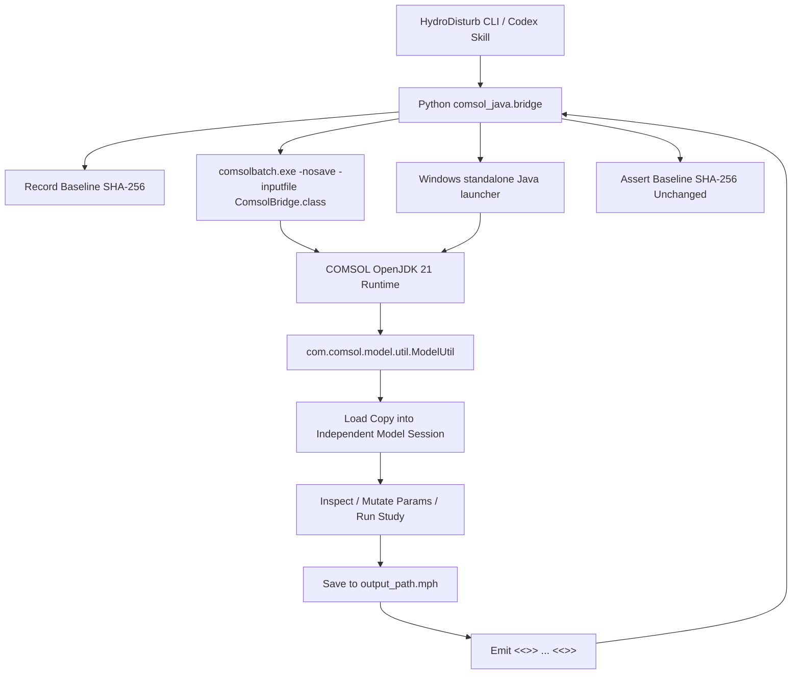

# COMSOL Java API Integration Architecture

This document describes the design, implementation, and safety mechanisms for connecting HydroDisturb-Bench with COMSOL Multiphysics 6.4 via the official Java API.

As of the [M3 amplitude-series delivery](reports/M3_PULSE_AMPLITUDE_SERIES_20261106.md), this path has been used for real model inspection, numerical sensitivity studies, saved-solution sampling, and controlled native-state branches. These are bounded experiment results, not a production training dataset or an exact-solution error guarantee. The legacy MPh adapter remains available through `probe` and `solve`; the accepted M3 experiments use the Java bridge and dedicated Python runners.

## 1. Technical Rationale & Architecture

HydroDisturb-Bench controls 2D cylinder CFD models through the official COMSOL Java API. Python discovers the installation, compiles the bridge, launches `comsolbatch` or the Windows standalone launcher described below, and validates structured results and source identities.

## 2. Environment Verification

The local installation was confirmed via Windows Registry `HKLM:\SOFTWARE\COMSOL\COMSOL64\COMSOLROOT`:
- **COMSOL Root**: `D:\Program Files\COMSOL64\Multiphysics`
- **COMSOL Version**: 6.4.0.429 (Win64)
- **Java Runtime**: OpenJDK 21.0.11 LTS (`java\win64\jre\bin\java.exe` & `javac.exe`)
- **Native Toolchain**:
  - `bin\win64\comsolcompile.exe`
  - `bin\win64\comsolbatch.exe`
  - `bin\win64\comsolmphserver.exe`
- **Official Documentation**:
  - `COMSOL Programming Reference Manual` (`doc\pdf\COMSOL_Multiphysics\COMSOL_ProgrammingReferenceManual.pdf`)
    - Chapter 1: Java API Overview & Standalone Execution
    - Chapter 2: `ModelUtil`, `ModelNode`, `Parameters`, `Study`, `Solver`

### 2.1 Platform Scope

The project standardizes both the local development workstation and future remote compute servers on **Windows 64-bit**.

| Platform Tier | Scope & Status | Technical Implementation & Guarantees |
|---|---|---|
| **Tier 1: Supported target; local execution evidence archived** | **Windows + COMSOL Multiphysics 6.4 (Win64)** | The documented workstation has real inspection, solving, export, source-hash, and regression records. Windows is also the intended remote-compute target; each target installation still needs its own license, toolchain, DLL-loading, and filesystem checks. Local acceptance does not certify every remote host or eliminate every possible filesystem failure. |
| **Tier 2: Unverified / Unaccepted (Phase 1)** | **Linux / POSIX Systems** | Cross-platform stubs (e.g. `fcntl`, `SYS_renameat2`) exist in the repository, but **Linux compatibility is NOT formally accepted for Phase 1 production use**. The project explicitly does not claim full cross-platform verification at this stage. Linux-specific production certification is deferred to future work. |

### 2.2 Windows Native Startup Recovery

Most bridge commands first use `comsolbatch`. Windows `export-s1-diagnostics` goes directly through the standalone launcher because PNG export needs software rendering and isolated preferences. For the other commands, if batch output contains both
`Failed to start COMSOL` and `FlNativeException`, and contains no `<<<JSON_START>>>`
marker, it invokes the same bridge command through the standalone COMSOL Java API.
This addresses the observed `csutil.dll` dependent-library lookup failure before the
bridge command begins. Unknown startup failures, partial JSON output, and structured
model or solver errors do not trigger this launcher retry.

The fallback uses the installed `java/win64/jre/bin/java.exe` and `javac.exe`, with the
installed `plugins/*` classpath (including COMSOL APIs and bundled JNA). It compiles
[ComsolStandalone.java](../src/hydro_disturb_bench/comsol_java/ComsolStandalone.java)
in a fresh temporary directory, then calls `ModelUtil.initStandalone` and the existing
`ComsolBridge.main`. Plotting support is enabled for diagnostic image exports. No
additional Java packages, COMSOL installation edits, or global environment changes are
required.

Before initializing COMSOL, the standalone JVM calls Windows `AddDllDirectory` for
`bin/win64`, `lib/win64`, and `java/win64/jre/bin`, then enables default DLL search
directories with `SetDefaultDllDirectories`. These settings are limited to that JVM;
they do not change other processes or the installed DLL files.

The temporary class directory and installation path must be ASCII. Model paths,
export paths, and other command arguments can contain Chinese text or emoji: Python
encodes them as UTF-8/base64, and Java decodes them before invoking the bridge. The
original model paths remain in use; models are not copied to ASCII aliases. The
temporary launcher directory is removed after the JVM exits.

Successful responses record `launch_mode` as `comsolbatch` or `standalone_java_api`.
When recovery was used, `batch_startup_failure` retains the original batch stdout,
stderr, and exit code. The normal JSON validation, model hash checks, staging, and
publication rules still apply. This recovery does not retry a solver command that has
already returned bridge output. Focused contract tests cover the retry boundary and
Unicode argument preservation; actual simulation and regression results are recorded
separately in the corresponding run reports.

## 3. Strict Safety Contracts

### 3.1 Baseline Model Immutability & Pre-Publish Verification
An input model (for example, the original `case/cylinder_flow.mph` template) is protected by identity and must remain unchanged. This protection alone does not establish its Reynolds number or physical accuracy; the calibrated Re=100 and M3 cases have separate experiment evidence.
- Before every operation (even read-only inspection), the SHA-256 hash of the input file is computed.
- **Pre-Publish Verification**: In mutating operations (`update_parameter`, `run_study`), the hash of the source model is re-verified **before** any attempt to publish the final output file.
- If the source hash mutated during execution, the staging file is safely quarantined as `failed_*`, `ModelValidationError` is raised, and the destination `output_path` is **never published**.

### 3.2 Task-Isolated Staging, Task Leases, and Cross-Process Atomic Publication Protocol
The contracts in this subsection describe the general bridge wrappers such as `update_parameter`, `run_study`, and `export_solution_data`. The frozen experiment runners also use explicit independent run directories and identity checks; they must not be assumed to inherit every wrapper's staging or recovery behavior merely because they call the same Java bridge.

Direct in-place modification or uncoordinated file generation is strictly prohibited:
- Parameter updates, solver runs, case building, and solution field data exports (TXT) require an `output_path` distinct from the baseline model and adhere to the unified staging transaction protocol.
- Symbolic links are strictly rejected (`output_path.is_symlink()`).
- **Task Isolation & Active Leases**: COMSOL executes against an isolated task-specific staging path:
  `output_path.parent / ".staging" / f"stage_{task_id}_{output_path.name}"`.
  The task creates and holds an exclusive lease lock on `.staging / f".lease_{task_id}.lock"` via `task_staging_session`. This OS-level kernel lock remains active for the full duration of computation and publishing.
- **Active Task Protection in Recovery**: `recover_unclaimed_staging` checks whether the lease file actually exists on disk (`has_lease`) and whether the task is active (`is_task_active()`). Any task holding an active lease lock or living PID is **strictly skipped and preserved**. Unleased files or recently terminated tasks younger than `min_age_sec`, or files with unconfirmed status / currently open in another process, are strictly preserved in staging. Only confirmed dead orphan tasks (`file_age >= min_age_sec`, lease released, PID dead, file unlocked) are safely archived into `quarantine/orphan_{name}`.
- **Quarantine Non-Destructive Archiving & Collision Avoidance**: Quarantine and orphan archiving strictly **forbid overwriting existing diagnostic artifacts**. If a destination artifact with the same name already exists in `quarantine/`, a collision-free unique path is generated (`{stem}_{timestamp}_{counter}{suffix}`). Staging files are never unlinked upon transfer failure; they remain intact in `.staging` with warnings logged.
- **Cross-Process Coordination**: Publication is guarded by an OS-level file lock:
  `output_path.parent / ".locks" / f"{output_path.name}.lock"`, utilizing `msvcrt.locking` on Windows and `fcntl.flock` on POSIX.
- **Strict Default Overwrite Prohibition**: `allow_overwrite` defaults to `False`. If another process has already published to `output_path`, the incoming task fails closed and raises `FileExistsError`.
- **Cross-Platform Atomic No-Overwrite & Fail-Closed Guarantee**:
  - Windows: Uses `os.rename()`, which is guaranteed by the OS kernel to fail with `FileExistsError` (WinError 183) if the destination exists.
  - POSIX / Linux: Uses `os.link()` followed by `unlink()`, which is guaranteed by POSIX specification to fail with `FileExistsError` (`EEXIST`) if the destination exists. When fallback `_posix_rename_noreplace` (`SYS_renameat2` with `RENAME_NOREPLACE`) is used, `errno` is safely captured via `ctypes.CDLL(None, use_errno=True)`. If atomic no-overwrite cannot be guaranteed, the operation **fails closed** (never falls back to `replace()`, strictly eliminating TOCTOU overwrite race conditions).
- **Conflict Quarantine**: When a successful computation cannot publish because the destination exists and overwrite is forbidden, the completed staging file is moved to `quarantine/conflict_{task_id}_{output_path.name}` without overwriting any existing diagnostic file. This guarantees that user computation is never silently lost or overwritten, allowing auditing or manual recovery.
- **Failure Quarantine**: If COMSOL crashes or leaves a corrupt staging file, it is moved to `quarantine/failed_{task_id}_{output_path.name}` without overwriting existing failure dumps.
- **Crash / Orphan Recovery**: Orphaned staging files from interrupted or aborted runs can be audited and recovered using `recover_unclaimed_staging(directory)` and `list_quarantine_records(directory)`. Recovery is idempotent and safe against repeated executions.

### 3.2.1 Field Data Export Pre-Publish Admission Contract
In addition to staging isolation, `export_solution_data()` enforces strict data-contract validation on the staging text file before any attempt to publish to the target path:
- **Header Structure**: Dynamically parses `% x y ...` coordinates and all field column tokens `<expr> [(<unit>)] @ t=<time>`.
- **Per-Time Completeness**: Every exported time step must contain all required expressions (`u, v, p, vx-uy, spf.U`).
- **Uniqueness**: Expression and time combinations must be strictly unique (rejects duplicated columns).
- **Physical Unit Consistency**: Reported units must match expected physical quantities (`u: m/s`, `v: m/s`, `p: Pa`, `vx-uy: 1/s`, `spf.U: m/s`).
- **Column & Row Sanity**: Numerical row column counts must strictly equal header token count; row count must be non-zero and match `% Nodes:` metadata when present.
- **Strict Finiteness**: Every single numerical field value is scanned; any NaN or Inf immediately causes rejection.
- **Fail-Closed Gate & Isolation**: Any failure raises `ModelValidationError` (wrapping `ComsolExportValidationError`), quarantines the corrupted staging artifact as `quarantine/invalid_data_*`, and guarantees the destination file (and any pre-existing file there) is **never touched or overwritten**.

### 3.2.2 S1/S1-A2 Multi-File Diagnostic Export Transaction Protocol
For complex multi-file diagnostics (7 time series + dynamic vorticity snapshot images), `export_s1_diagnostics()` enforces complete atomic transaction semantics:
- **Dedicated Lock File Guarantee**: `file_publish_lock()` validates the lock target path. When the publication target is a directory `output_dir`, it derives a dedicated lock file (`.publish_{output_dir.name}.lock`) in the parent directory, strictly preventing `open()` calls with write mode on directories.
- **Dynamic Snapshot Time Discovery**: In `ComsolBridge.java`, snapshot generation no longer relies on hardcoded solution frame indices. It queries `model.sol("sol1").getPVals()` to dynamically match target timestamps (e.g. $t \in \{10, 40, 100, 195, 200\}$ s) to the nearest available solver solution index (`solnum`), ensuring seamless support for arbitrary simulation lengths and output schedules.

  This is the legacy diagnostic-image path. The newer Cartesian field-sampling path below requires an exact saved time and rejects nearest-frame substitution; the two contracts are different.
- **Two-Phase Staging & Verification**: All diagnostic files are generated inside an isolated staging directory (`output_dir / ".staging" / f"stage_{stage_id}"`). Before any file is published, all 7 time-series files and PNG snapshots undergo full validation (step count, header tokens, physical units, finiteness, non-empty image size).
- **Cryptographic Commit Token (`manifest.json`)**: Upon successful generation and validation, a `manifest.json` is computed in staging. It records:
  - Source model SHA-256 hash (verified before and after solver execution);
  - Stage ID and ISO 8601 UTC timestamp;
  - Expected time series steps (e.g., 501 for 100s, 1001 for 200s) and time range;
  - Result status: `"COMPLETED"`;
  - Complete file catalog mapping each diagnostic file to its byte size and SHA-256 hash.
- **Version Archiving & Zero In-Place Overwrite**: If `allow_overwrite=True` and a valid previous result set already exists in `output_dir`, the entire previous set is archived into `output_dir / "versions" / f"run_{old_timestamp}_{old_stage_id}"` before any new file is promoted. `list_s1_diagnostic_versions()` and `recover_s1_diagnostic_version()` ensure lossless version history and disaster recovery.
- **Atomic Two-Phase Promotion**: Files are first moved into `output_dir / f".tmp_{stage_id}_{fname}"`. If all files are successfully staged in `output_dir`, they are promoted via atomic `os.replace`, with `manifest.json` promoted **last** as the commit token. Any directory without a valid `manifest.json` matching all file SHA-256 hashes is considered incomplete and uncommitted.
- **Failure Quarantine & Staging Preservation**: If an error occurs at any point (e.g. COMSOL crash, data validation rejection, or failure promoting file 1, 5, or 11), temporary `.tmp_` files are cleaned up, pre-existing results remain completely untouched, and the full staging directory is safely moved to `quarantine/` via `quarantine_staging_dir` with a detailed `quarantine_reason.txt`. Staging files are never silently deleted with `ignore_errors=True`.

### 3.3 Dynamic Discovery & Live Geometric Evidence (Zero Guessing)
- General inspection and case-building operations discover nodes and associations from the live model. Frozen M3 runners additionally use previously inspected tags and selections, then verify their expected types, source links, and identities. They are guarded experiment-specific entry points, not adapters for arbitrary uninspected models.
- Parameters (`U_mean`, `H`, `L`, `W`, `R`) are verified for existence and units prior to applying changes.
- **Live Geometric Boundary Query**: Geometry boundaries are dynamically queried using official COMSOL methods (`geom.getNBoundaries()`, `geom.getBoundingBox()`, `geom.getUpDown()`, `geom.edgeParamRange()`, and `geom.edgeX()`). No hardcoded boundary coordinate maps are emitted. Every boundary's bounding box, length, up/down domain references, and spatial sample coordinates are dynamically computed from the live geometry kernel in memory.
- **Geometric Selection Verification**: In `build_re100_case`, boundary entities for inlet, outlet, lateral symmetry, and cylinder wall are classified directly from live `edgeX` spatial samples against the domain bounding box and cylinder center/radius. Physics feature selections (`inl1`, `out1`, `sym1`, `wallbc1`) and mesh features (`bl1`, `size1`) are read back and required to match geometric classification with zero tolerance.

### 3.4 Two-Grade Verification Architecture
To maintain clear separation of concerns, the system defines two independent acceptance grades:
- **Grade 1: COMSOL API Solver Execution & Numerical Sanity (Round 1 Scope)**
  1. `sol.getPVals()`: Confirms non-empty time step arrays matching requested ranges.
  2. `sol.getU(1)`: Extracts solution field degree-of-freedom vectors (e.g. 70,139 DOFs).
  3. **NaN / Inf Scanning**: Verifies that every component in the solution vector is finite and non-NaN.
  4. **Non-Triviality**: Verifies that the field contains non-zero physical flow data.
  5. If any numerical check fails, the bridge aborts with `SOLVER_FAILED`, and the model is not saved.
- **Grade 2: Experiment-specific numerical and physical checks**
  Re=100 calibration, periodic lift/drag statistics, M0–M3 native-mesh comparisons, and the M3 time-step cross-check have execution evidence. [M3 mesh results](STAGE_S1B2_M3_20261105.md) and [M3 time-step results](STAGE_S1B3_M3_TIME_20261105.md) passed their stated four-metric engineering criteria. The retained native domain is 0.4×0.24 m, with a 0.01 m cylinder; it is distinct from the planner's original candidate geometry.

  These results do not establish domain-size independence, a pointwise full-field error bound, formal GCI/Richardson uncertainty, or agreement with every literature setup. Source-force integrals and impulses in the later pulse experiments are not a full fluid momentum budget. Keep those remaining checks separate from the completed API and selected-statistic gates; see [VALIDATION.md](VALIDATION.md).

### 3.5 Error Codes and Exception Hierarchy
The interface enforces typed error categories:
- `MODEL_NOT_FOUND`: Target `.mph` file does not exist.
- `API_UNSUPPORTED`: Requested Java API not present in current COMSOL version.
- `NODE_NOT_FOUND`: Target component, geometry, mesh, physics, or study tag not found.
- `INVALID_PARAMETER`: Target parameter is not defined in model, or expression is malformed.
- `INVALID_UNIT`: Parameter unit is unrecognized or dimensionally invalid.
- `COMSOL_CONNECTION_FAILED`: Subprocess execution failed, comsolbatch crashed, or JSON schema malformed.
- `MODEL_VALIDATION_FAILED`: Baseline hash mutated or staging file invalid.
- `SOLVER_FAILED`: COMSOL solver exited with error, produced NaN/Inf, or failed to record solution steps.

## 4. Verified Java API Methods

The following official COMSOL Java API methods are compiled and verified in `ComsolBridge.java`:

| Method | Documentation Section | Purpose |
|---|---|---|
| `ModelUtil.loadCopy(tag, path)` | Programming Reference Manual Ch. 2 | Safely loads a copy of the model into memory without holding file locks on source |
| `ModelUtil.getComsolVersion()` | Programming Reference Manual Ch. 2 | Queries runtime COMSOL build and version |
| `model.component().tags()` | Programming Reference Manual Ch. 2 | Enumerates model components dynamically |
| `model.geom(tag).getSDim()` | Programming Reference Manual Ch. 2 | Queries geometry spatial dimension |
| `geom.getNBoundaries()` | Programming Reference Manual Ch. 2 (GeomSequence) | Queries total boundary edge count in geometry |
| `geom.getBoundingBox()` | Programming Reference Manual Ch. 2 (GeomSequence) | Retrieves `[xmin, xmax, ymin, ymax]` of geometry domain |
| `geom.getUpDown()` | Programming Reference Manual Ch. 2 (GeomSequence) | Retrieves domain adjacency for all boundary entities |
| `geom.edgeParamRange(b)` | Programming Reference Manual Ch. 2 (GeomSequence) | Retrieves parameter interval `[smin, smax]` for boundary `b` |
| `geom.edgeX(b, s)` | Programming Reference Manual Ch. 2 (GeomSequence) | Computes exact coordinates `(x, y)` along boundary `b` |
| `model.physics().tags()` | Programming Reference Manual Ch. 2 | Enumerates active physics interfaces |
| `model.param().varnames()` | Programming Reference Manual Ch. 2 | Queries all parameter identifiers |
| `model.param().get(name)` | Programming Reference Manual Ch. 2 | Gets parameter raw expression string |
| `model.param().evaluate(name)` | Programming Reference Manual Ch. 2 | Evaluates parameter expression to double |
| `model.param().evaluateUnit(name)` | Programming Reference Manual Ch. 2 | Evaluates parameter unit string |
| `model.param().set(name, expr)` | Programming Reference Manual Ch. 2 | Sets parameter value and unit |
| `model.study().tags()` | Programming Reference Manual Ch. 2 | Enumerates study nodes |
| `model.study(tag).run()` | Programming Reference Manual Ch. 2 | Executes solver sequence |
| `model.sol().tags()` | Programming Reference Manual Ch. 2 | Verifies generated solution nodes |
| `model.save(outputPath)` | Programming Reference Manual Ch. 2 | Persists solved/modified model to target path |

## 5. Command-Line Interface (CLI)

The installed `hydrobench` command and `python -m hydro_disturb_bench.cli` use the same parser. The Java subcommands use named options and accept neither `--out` nor `--log-out`. Structured results are printed to stdout. The examples below use placeholder model/output names and are not instructions to rerun an accepted experiment.

| Operation | Actual CLI syntax |
| --- | --- |
| Installation inspection | `hydrobench java-inspect-api` |
| Read-only model inspection | `hydrobench java-inspect --model MODEL.mph` |
| Parameter update on a copy | `hydrobench java-update-param --model MODEL.mph --output COPY.mph --name PARAM --expr '1.2[m/s]' --descr 'Description'` |
| Study execution | `hydrobench java-solve --model MODEL.mph --output SOLVED.mph --study std1 --tlist 'range(0,0.2,200)'` |
| Re=100 case construction | `hydrobench java-build-re100 --model TEMPLATE.mph --output BENCHMARK.mph` |
| Generic five-channel text export | `hydrobench java-export-data --model SOLVED.mph --output FIELDS.txt` |
| Legacy diagnostics and PNGs | `hydrobench java-export-s1-diagnostics --model SOLVED.mph --output-dir NEW_DIAGNOSTICS` |

`java-solve` requires `--study`; `--tlist` is optional. The mutating/export commands expose `--allow-overwrite`, defaulting to false; the dedicated experiments below preserve prior runs and use separate output directories. The generic text export contains `u,v,p,vx-uy,spf.U`; it is not the `(T,3,Ny,Nx)` sampling interface.

## 6. Saved M3 Fields and Native Branches

The implemented Cartesian sampler exports `[u,v,p]` in `[m/s,m/s,Pa]`, with explicit increasing x/y axes, actual saved times, and separate cylinder/invalid masks. It writes compressed NPZ arrays plus metadata and original COMSOL TXT exports. Fluid values must be finite; masked tensor entries are NaN. These are evaluated point samples, not a claim of conservative cell-average projection. HDF5/Zarr training packaging and trajectory splits remain future work.

| Entry point | Scope and prerequisites |
| --- | --- |
| `python scripts/sample_re100_m3_fields.py --output NEW_SAMPLE_DIR` | Existing pinned M3 solution, five saved times, 81×49 and 161×97 grids; no CFD solve or model save. |
| `python scripts/sample_re100_m3_sequence.py --output NEW_SEQUENCE_DIR` | Existing M3 and accepted five-frame overlap reference; 151 frames from 170–200 s, 32-frame batches, 161×97. No CFD solve. |
| `hydro_disturb_bench.field_sampling.load_full_field_sample(path)` | Offline NPZ/metadata validation for one sample batch. |
| `hydro_disturb_bench.field_sequence.load_full_field_sequence(path)` | Offline manifest/hash validation of all seven arrays; concatenates time-dependent arrays while checking shared axes and cylinder masks. |
| `python scripts/run_m3_branch_pulse.py --help` | Frozen zero/0.005 m/s² branch experiment; explicit prepare/solve/sample/analyze stages and optional verified checkpoint reuse. |
| `python scripts/run_m3_pulse_amplitude_series.py --help` | Frozen 0.0025/0.010 m/s² additions; reuse of accepted zero/0.005 controls. Stages: precheck, solve, sample, analyze, all. |

The sampling scripts and original branch runner resolve historical data relative to their checkout. The amplitude-series runner separately supports `HYDRO_DATA_ROOT`; its default is the checkout root. This variable does not globally relocate every legacy test or script. `precheck` and `analyze` need the pinned local data but do not solve CFD; `sample` calls COMSOL to evaluate existing solutions; `solve` and `all` execute new Time solves. Both branch runners default to `all`, so use explicit stages when reproducing a single operation.

Native continuation uses a full `copySolution` checkpoint with the original t=180 s saved frame 901 and its U/UDot. It does not reconstruct finite-element state from the NPZ grid and does not claim to restore the original BDF step history. The frozen `native-restart-consistent-off-v2` protocol changes initialization to `consistent=off` for both branches; `rtol=1e-4` and `const / 0.05 s` remain fixed. Source/selected input hashes, Variables probes, and actual first-frame differences are recorded separately. The original branch command accepts only 0/0.005 m/s²; the distinct amplitude-series command accepts only 0.0025/0.010 with its required series ID.

Evidence navigation:

- [Five-frame, two-grid sampling](STAGE_M3_FIELD_SAMPLING_20261105.md) and [151-frame sequence](STAGE_M3_FIELD_SEQUENCE_20261105.md).
- [Native zero/pulse restart](STAGE_M3_BRANCH_PULSE_20261105.md) and [three-amplitude comparison](reports/M3_PULSE_AMPLITUDE_SERIES_20261106.md).
- [Amplitude-series Git-blob auditor](evidence/m3_pulse_amplitude_series_20261106/audit_delivery.py), which needs no local model or full field data; use its fixed delivery commit, as described in [PUBLISHING.md](PUBLISHING.md).

## 7. Invocation-local Process Recording and Branch Services

`comsol_java.run_command(args, root=None, *, process_runner=None)` is the public low-level command entry. A supplied runner follows the `subprocess.run`/`CompletedProcess` contract and is passed explicitly to bridge compilation, batch execution and standalone fallback. The default path retains the previous launch and error behavior. Sample and sequence exports also accept `process_runner` and forward it through every batch.

The branch scripts use shared services in `hydro_disturb_bench.experiments` for execution evidence, raw process recording, completed-stage checks, sampling and solver-step analysis. The amplitude script no longer executes the original CLI through `importlib` or depends on its private helpers. Raw stdout/stderr, partial payloads and failure records remain separate files; implementation evidence includes the extracted service modules and the calling entrypoint. Old saved records remain readable.

Process recording does not patch global `subprocess.run`. Overlapping fake executions verify isolated runner/log ownership; this does not certify concurrent COMSOL solves or shared Java compilation. The Java sources and numerical acceptance contracts are unchanged by this extraction. Splitting Java classes and the bridge's filesystem transaction layer remains separate work.

The archived Windows regression record and a new local test execution are different evidence. Data-free checks select `not integration and not artifact`. Selecting `artifact` requires the retained MPH/diagnostic files; selecting `integration` requires COMSOL. See [the software-maintenance report](reports/CODE_HEALTH_CI_20261106.md) and [publishing evidence boundaries](PUBLISHING.md).
