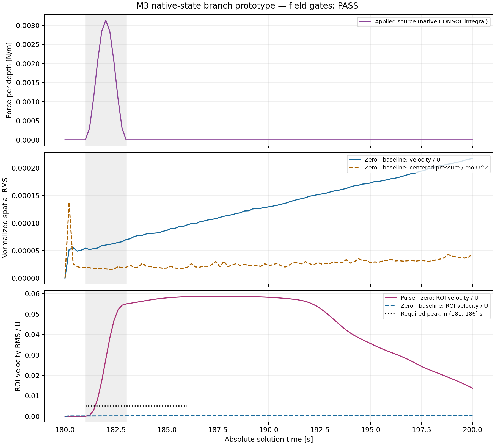
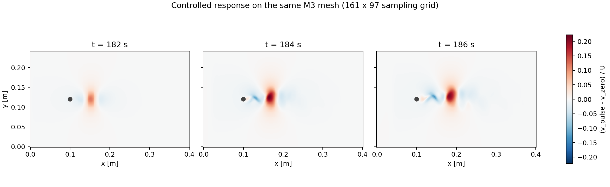

# M3 原生共同起点：零扰动与局部体力脉冲

**结果：PASS。** 已从原 M3 的 `sol1 / solnum 901 / t=180 s` 生成两条新的 180–200 s 未来，并分别导出 101 帧 `(101,3,97,161)`、`float64` 的 `[u,v,p]` 连续张量。零分支通过原先冻结的续算误差门；脉冲分支通过脉冲前一致性和响应幅度门。源模型和已有成果保留。本实验编号为 20261105，最终审计及归档完成于北京时间 2026-11-06。

**远程采用轻量交付。** 仓库提供代码、指标、精简真实回读、步进及回归日志、PNG 和哈希清单；超过 1 MiB 的原始 ZIP 仅保存在本机同一证据目录。远程材料可以用于代码、数值摘要、设置和日志复核，但不包含完整原生向量与场张量，不能仅凭远程副本重新执行全量原始数据审计。

**必须披露的执行变更：两个新分支都将 Time 初始化设置 `consistent` 从 `bweuler` 改为 `off`。** 原策略在真实零分支的首步失败；在尚无完整新未来时，已冻结独立的 [restart protocol v2](evidence/m3_branch_pulse_20261105/restart_protocol_v2.json) 和 [冻结记录](evidence/m3_branch_pulse_20261105/restart_protocol_v2_freeze_record.json)。这是一项实际求解器变更，不声称相对原基线所有求解设置完全未变。两分支采用同一新协议，物理脉冲和全部原定数值阈值保持不变。

## 复核入口

| 内容 | 入口 |
|---|---|
| 正式总判定、未四舍五入指标 | [analysis_report.json](evidence/m3_branch_pulse_20261105/analysis_report.json)、[field_comparison.json](evidence/m3_branch_pulse_20261105/field_comparison.json) |
| 原生输入、实际单位与设置 | [prepare 摘要](evidence/m3_branch_pulse_20261105/prepare_readback_summary.json)、[zero 摘要](evidence/m3_branch_pulse_20261105/zero_readback_summary.json)、[pulse 摘要](evidence/m3_branch_pulse_20261105/pulse_readback_summary.json)、[native_validation.json](evidence/m3_branch_pulse_20261105/native_validation.json) |
| 原始 COMSOL 返回及原生向量的身份 | [archive_manifest.json](evidence/m3_branch_pulse_20261105/archive_manifest.json)：记录本机 `native_runtime.zip` 的字节数、SHA-256 及成员清单；该大包不上传 |
| 完整步进表的可读副本 | [zero_solver_stdout.txt](evidence/m3_branch_pulse_20261105/zero_solver_stdout.txt)、[pulse_solver_stdout.txt](evidence/m3_branch_pulse_20261105/pulse_solver_stdout.txt)、[step_validation.json](evidence/m3_branch_pulse_20261105/step_validation.json) |
| 场数据索引与原始文件清单 | [zero 索引包](evidence/m3_branch_pulse_20261105/native_zero_index.zip)、[pulse 索引包](evidence/m3_branch_pulse_20261105/native_pulse_index.zip)、[archive_manifest.json](evidence/m3_branch_pulse_20261105/archive_manifest.json)；原始 TXT / NPZ 分批大包仅保存在本机 |
| 本机全量 TXT / NPZ / 直接求值审计记录 | [field_artifact_audit.json](evidence/m3_branch_pulse_20261105/field_artifact_audit.json)、[审计脚本](evidence/m3_branch_pulse_20261105/audit_branch_fields.py)；重新执行需要本机原始场数据 |
| 完整离线回归与定向复测 | [offline_regression.stdout.txt](evidence/m3_branch_pulse_20261105/offline_regression.stdout.txt)、[targeted_retry.stdout.txt](evidence/m3_branch_pulse_20261105/targeted_retry.stdout.txt)、[执行元数据](evidence/m3_branch_pulse_20261105/regression_summary.json) |
| 首次定向失败及全部测试原始日志 | [targeted_first_attempt.stdout.txt](evidence/m3_branch_pulse_20261105/targeted_first_attempt.stdout.txt)、[execution_logs.zip](evidence/m3_branch_pulse_20261105/execution_logs.zip) |
| 失败轨迹与执行方法修订 | [execution_protocol_note.md](evidence/m3_branch_pulse_20261105/execution_protocol_note.md)、[失败归档清单](evidence/m3_branch_pulse_20261105/archive_manifest.json)；五个准备失败原始大包仅保存在本机 |
| 历史保护与归档字节 | [history_audit_final.json](evidence/m3_branch_pulse_20261105/history_audit_final.json)、[evidence_manifest.json](evidence/m3_branch_pulse_20261105/evidence_manifest.json) |

精简回读保留实际单位、表达式、Dataset、求解器与体力节点字段；base64、长日志和大型 DOF 数组明确删省，大数组以数量及 SHA-256 标识。摘要中的哈希不能代替被删省的原始数据。**完整原始返回仍逐字节保存在本机 ZIP 内，远程不提供该大包。** 可读日志只取原始 stdout 的 JSON 包络之前部分，规范化为 LF 并去除行尾水平空白；原始 stdout 的哈希不能拿来核对该可读副本。两种文件的身份和转换规则分别记录在清单中。交付检查发现早期可读副本曾把换行写成字面 `\n`，已从本机 ZIP 内经过哈希核验的原始 stdout 重建，原始归档未改动。求解模型 `.mph` 留在本机独立运行目录，未上传；其实际 SHA-256 保存在执行记录及归档清单中。

## 实验与共同起点

| 项目 | 两支共同值或规定差异 |
|---|---|
| 源模型 | `runs/re100_s1b2_m3_20261105_verified/re100_s1b2_m3_solved.mph` |
| 源模型 SHA-256 | `15e841fc4240d93db877932c1b371646426f1229bdb40d0335b0ed7609d145b4` |
| 原生起点 | `sol1` 第 901 个保存状态，180 s；完整 `copySolution` 保留 1001 帧原生解 |
| 共同种子 | `sol_branch_seed / 901`；U 和 UDot 都与源状态逐字节相同 |
| U SHA-256 | `c614d848b3688de967916432f7f06d3df32b42273f54dec6c76c3563a960733b` |
| UDot SHA-256 | `a91258fc0f7fd9c9ea4b8ff67cb0a9efc597960892b4e7d285d733b87e358696` |
| 共同 checkpoint SHA-256 | `7d052c545ce0428682a905d407e69cbe466984456d99dc9e72730728c646cf8c` |
| 原生网格 | 34,752 单元、17,910 顶点、88,483 原生自由度；其中 53,730 个物理自由度、34,753 个内部自由度 |
| 时间积分 | `rtol=1e-4`、`maxstepconstraintbdf=const`、`maxstepbdf=0.05 s`；两支均 `consistent=off` |
| 输出 | 180–200 s，间隔 0.2 s，共 101 帧；绝对时间不归零 |
| 脉冲差异 | 零支加速度幅值为 0；脉冲支为 0.005 m/s²，其余定义相同 |

初始化直接引用原生保存状态，未把规则采样张量反插值回模型。BDF 的积分历史重新建立；这不等同于恢复旧求解器全部内部历史。代码先执行的 Variables 探针是独立预检，不能冒充随后 `runAll(false)` 内部的 Time 输入。预检向量及实际首帧之间存在浮点差异；物理分量的首帧差异约为 `10^-17`，辅助场 `spf.dt2Inv_u` 被重新计算。原生校验逐项报告这些差异，没有把实际首帧或预检误写成逐字节相同。严格字节约束作用于源、种子及实际选定的原生 U/UDot；新积分结果使用冻结的场误差门验收。

实际可读取属性、网格指纹及来源关联检查通过；九次快照合计 **81 条不可读取属性观测**单独列出，并非 81 项已独立验证。模型由源解复制，只实施已记录变更；不扩大为所有材料、边界和隐藏求解器属性均逐项独立核验。

`runAll`、`copySolution` 与 `getUDot(int)` 的语义参考 [COMSOL solver API](https://doc.comsol.com/6.4/doc/com.comsol.help.comsol/comsol_api_general.47.58.html) 和 [SolverSequence API](https://doc.comsol.com/6.4/doc/com.comsol.help.comsol/api/com/comsol/model/SolverSequence.html)。官方将 `consistent=off` 描述为不执行该项一致性初始化修正，适用于已有一致初值；本实验通过实际零分支误差门评估这个选择，不声称已独立证明全部 DAE 约束严格满足，也不声称 backward Euler 初始化是之前失败的唯一原因。[Time-Dependent Solver](https://doc.comsol.com/6.4/doc/com.comsol.help.comsol/comsol_ref_solver.36.139.html)

## 扰动及真实来源回读

局部体力中心为 `(0.15,0.12) m`，高斯标准差 `0.01 m`，方向为 `+y`，仅在 `181<t<183 s` 施加。时间包络为 `sin²(π(t−181)/2)`，区间外及端点为零，平滑开启和关闭。空间包络为 `exp(-((x−0.15)²+(y−0.12)²)/(2×0.01²))`。实际物理特征为 `branch_vf`，选择流体域 1。

COMSOL 体力输入为体积力密度：`Fy=rho_f*branch_A*空间包络*时间包络`。`branch_A=0.005 m/s²` 是加速度，不是 `0.005 N/m³`。实际 `rho_f=998.2 kg/m³`，中心峰值为 **4.991 N/m³**。物理节点表达式、EvalPoint 的 `N/m³`、IntSurface 的 `N/m`、Dataset `dset1 → sol1` 及求值时间均来自实际执行后的回读。[COMSOL Volume Force](https://doc.comsol.com/6.4/doc/com.comsol.help.cfd/cfd_ug_fluidflow_single.06.029.html)

| 来源量 | 真实回读 / 积分 | 冻结参考值 | 相对误差 |
|---|---:|---:|---:|
| 182 s 体力面积积分，N/m | 0.0031359350552924645 | 0.0031359350545522137 | 约 2.36×10⁻¹⁰ |
| 181–183 s 脉冲冲量，N·s/m | 0.0031359350552924636 | 0.0031359350545522137 | 约 2.36×10⁻¹⁰ |

二者均通过原定 1% 相对误差门，零分支及脉冲区间外的源为零。这是每单位面外厚度的**施加源**，不是净流体动量变化；边界力及通量仍会参与动量收支。

## 续算误差与扰动响应

记原连续基线为 B，新零分支为 Z，脉冲分支为 P。速度使用 u、v 联合向量范数，无额外除以 2。空间采用全域 x/y 张量积梯形面积权重，排除实际掩码；压力先分别去除加权空间均值，另报原始均压偏移。时间 RMS 为逐帧空间 RMS 平方在 180–200 s 的梯形时间平均后开方。`U=0.010058104588258865 m/s`，压力尺度为 `rho_f*U²`。

| 零分支相对原基线 Z−B | 结果 | 原定上限 | 判定 |
|---|---:|---:|---|
| 速度时空 RMS / U | **0.0139575%** | 0.5% | PASS |
| 速度最大逐帧空间 RMS / U | **0.0217751%** | 1% | PASS |
| 去均压差时空 RMS / (ρU²) | **0.00298005%** | 1% | PASS |
| 去均压差最大逐帧 RMS / (ρU²) | **0.0137850%** | 3% | PASS |

最大原始空间均压偏移为 `1.1187273175721911e-05 Pa`。这些是同一离散模型的重启等价性工程门槛，不是相对真实流场的误差界。

响应 ROI 为 `x∈[0.12,0.25] m, y∈[0.08,0.16] m`，采用全域梯形权重与 ROI 布尔选择，不重新赋予 ROI 边界半权。冻结的响应窗口为 `(181,186] s`；噪声取整个 180–200 s 内 Z−B 的最大 ROI 速度 RMS。

| 响应检查 P−Z | 结果 / U | 原定判据 | 判定 |
|---|---:|---|---|
| 脉冲前 `t≤181 s` 最大 ROI RMS | `5.15785886236e-7` | ≤ `max(1e-4,2×脉冲前Z−B噪声)` = `0.000247527124466` | PASS |
| 全窗口 Z−B 噪声底 | `0.000526594926822` | 用于响应门，不单独作为物理响应 | 已记录 |
| `(181,186] s` 峰值 ROI RMS | **0.0584715706954，即 5.84716% U**，186 s | ≥ `max(0.005,5×噪声底)` = **0.005，即 0.5% U** | PASS |

因此，在本次设定与噪声门下可以区分续算差异和脉冲造成的流场响应。200 s 时 ROI 响应仍为约 **1.3673% U**；本实验未要求在窗口末端恢复至零，也不把有限强度脉冲解释成线性响应。





## 采样、步进与数据审计

每支仍采用已验收的正式采样及 loader：全域包含端点的递增 x/y，`161×97`，通道 `[u,v,p]`，单位 `m/s,m/s,Pa`，保存解编号对应实际时间。圆柱中心 `(0.1,0.12) m`、半径 `0.005 m`；独立几何掩码与原始无效点共同决定最终 NaN 掩码。四批帧数为 **32+32+32+5**，跨批坐标、掩码、来源和时间连续性均核验。

| 数量 / 检查 | 每支 | 两支合计 |
|---|---:|---:|
| 张量条目 | 4,731,951 | 9,463,902 |
| 有效流体通道值 | 4,728,012 | **9,456,024** |
| 掩码内 NaN 条目 | 3,939 | 7,878 |
| 原始 TXT 文件 | 101 | **202** |
| 同坐标同时刻直接求值检查 | 303 个时空点 | **606 个时空点、1818 个通道值** |

本机独立审计逐个解析 202 个原始 TXT 的坐标、表头、时间和 `[u,v,p]`，与正式 loader 读回的 NPZ 比较全部有效值，差值为零；原始 NaN 每支 2727 项和最终掩码 NaN 每支 3939 项分别记录。606 次直接求值比较的最大通道差值也为零。独立梯形积分复算与正式指标差异最大 `1.39e-17`。远程保留这次审计的结果、脚本和来源哈希，重新完成该全量核验需要本机原始数据。这些零差值证明采样与同一保存离散解一致，不表示 CFD 物理误差为零。

两支实际完整 stdout 均含 **457 个连续、唯一编号的已接受内部步**，最大步长 **0.05 s**，最小打印步长 **0.00096408 s**，最终内部时间 **200 s**。101 个仅输出时刻行不计为内部步；打印时间精度有限，首个已接受时间仍可能显示为 180。Time 节点 `message` getter 只返回约 29,946 字符尾部且缺少表头，已如实标记不完整，正式验收使用原始进程 stdout 完整步进表。

零支、脉冲支执行包装器分别耗时约 111.75 s 和 110.74 s，包含加载、编译、求解和保存，不能当作纯求解 CPU 时间。

## 测试、失败与实现对应关系

| 本轮验证 | 实际记录 |
|---|---|
| 首次定向测试 | **1 failed, 211 passed in 11.74s**；旧连续序列 roundtrip 测试的 Windows 目录发布遇到 `WinError 5` |
| 同一代码定向复测 | **212 passed in 11.24s** |
| 完整离线回归 | **461 passed, 30 deselected in 30.29s**，`pytest -q -m "not integration"` |
| 新增真实 COMSOL 路径 | 两支真实求解、真实单位/源回读、完整步进日志及连续采样正式判定 PASS |
| 静态检查 | 新增 Python 生产代码及测试 Ruff 通过；Git 提交前检查见归档记录 |

212 项定向测试包含在 461 项离线回归中，不相加。30 项旧集成测试本轮未运行，不称为“全库全部测试通过”。首次 Windows 目录重命名失败与上一阶段已记录的可靠性风险相同；完整离线回归已包含并通过该测试，随后同代码定向复测通过。没有为此次失败改动已验收的发布逻辑；保留首次完整失败记录，根因仍未确定。

真实准备和求解失败均保留：早期原生单帧构造虽保留 U，但实际查到 UDot 全零；改为完整 `copySolution` 后保留 U/UDot。单独 `runFrom(Time)` 仍零步失败；`runAll(false)` 进入 BDF 后，原 `bweuler` 初始化即使在完整原生状态下仍于 `180.0004 s` 非线性不收敛。随后登记上述 `consistent=off` 协议，两支真实成功。没有放宽 Newton 设置、容差、力幅值或验收阈值。

预检向量跨支逐字节相同的遗留检查来自已放弃的分段求解路径。独立预检调用未观测随后 `runAll` 的内部 Time 输入，不能据此要求其跨支逐字节相同，故改为明确的诊断字段并保留原拒绝记录；源/种子/选定输入 U/UDot 严格检查和冻结场误差门不变。详细过程见执行说明及失败归档。

四个求解执行文件在执行时与交付时的版本分别保存在 [executed_sources.zip](evidence/m3_branch_pulse_20261105/executed_sources.zip) 和 [final_sources.zip](evidence/m3_branch_pulse_20261105/final_sources.zip)。在这四个文件中，两支求解后仅 runner 的内部步进解析器修正了对实际中文进度行的识别；未重跑 CFD。Java、Python COMSOL bridge 和 Java class 与真实求解时字节一致；[精确差异](evidence/m3_branch_pulse_20261105/post_solve_runner_diff.patch) 与执行哈希绑定保存在归档清单中，避免把后来修改的解析器误标为当时执行版本。该四文件对照不涵盖另行完善的后处理校验代码和归档工具。

## 数据包与复现

远程保留五个小 ZIP：[执行源码](evidence/m3_branch_pulse_20261105/executed_sources.zip)、[交付源码](evidence/m3_branch_pulse_20261105/final_sources.zip)、[测试原始日志](evidence/m3_branch_pulse_20261105/execution_logs.zip)、[zero 索引](evidence/m3_branch_pulse_20261105/native_zero_index.zip)、[pulse 索引](evidence/m3_branch_pulse_20261105/native_pulse_index.zip)。每个小于 115 KB；两份索引包不包含完整场张量。

以下 14 个大 ZIP 保存在本机 `docs/evidence/m3_branch_pulse_20261105/`，不进入远程 Git：`native_runtime.zip`；`native_zero_batch_0000.zip` 至 `native_zero_batch_0003.zip`；`native_pulse_batch_0000.zip` 至 `native_pulse_batch_0003.zip`；`preparation_failures_00.zip` 至 `preparation_failures_04.zip`。[archive_manifest.json](evidence/m3_branch_pulse_20261105/archive_manifest.json) 逐包标记 `storage=git` 或 `storage=local_only`，同时保留字节数、SHA-256 和成员清单。[evidence_manifest.json](evidence/m3_branch_pulse_20261105/evidence_manifest.json) 核对远程交付的可读副本、小 ZIP 和 PNG。不要拿原始字节哈希核对经 LF 转换的显示副本。

轻量交付审计入口为 [audit_delivery.py](evidence/m3_branch_pulse_20261105/audit_delivery.py)，本轮记录见 [git_blob_audit.json](evidence/m3_branch_pulse_20261105/git_blob_audit.json)。默认 portable 模式可在远程仓库副本中运行：

```powershell
python -X utf8 docs/evidence/m3_branch_pulse_20261105/audit_delivery.py `
  --git-ref HEAD --output <新的远程交付审计结果.json>
```

该模式核对远程文件和 Git blob；缺省不读取 `local_only` 大包，也不宣称已核验其完整内容。在保留上述大包的本机，加 `--include-local-archives` 可同时核对本地原始归档：

```powershell
python -X utf8 docs/evidence/m3_branch_pulse_20261105/audit_delivery.py `
  --git-ref HEAD --include-local-archives --output <新的完整本机审计结果.json>
```

两种交付审计均无需启动 COMSOL。936 个既有受保护文件的最终哈希在本机检查中均保持不变。

本机完整场核验可直接使用既有运行目录，或将本机 `native_runtime.zip`、两支索引包及八个 batch 大包合并解压到一个**新目录**，保留 ZIP 内相对路径。得到的运行目录为 `runs/re100_m3_branch_pulse_20261105_verified_v6`。具备这些原始数据后，无需 COMSOL 或 MPH 即可执行：

```powershell
python -X utf8 docs/evidence/m3_branch_pulse_20261105/audit_branch_fields.py `
  --run <新解压根目录>/runs/re100_m3_branch_pulse_20261105_verified_v6 `
  --output <新的审计结果.json>
```

若要复算 Z−B，需要另外提供已冻结的 151 帧原基线目录：给上述命令增加 `--baseline <原基线fields目录>`。仅核对 P/Z 数据不需要基线，但仍需要本机完整 P/Z 原始场数据；远程索引和精简回读不足以执行此命令。

当前 Windows 环境具备原 M3 模型和原基线时，可在**全新运行目录**重现实验（以下会实际求解两支，不属于离线审计）：

```powershell
python -X utf8 scripts/run_m3_branch_pulse.py --output runs/<全新实验目录> --stage all
```

本轮最终成功目录通过既有原生 checkpoint 分阶段运行；`run_manifest.json`、各 stage 的 `execution.json`、原始进程日志和完整回读记录实际调用。默认完整入口同样受物理计划和 restart protocol 的固定哈希约束。原计划 SHA-256 为 `72343d29335f761b82a5c3aa5b269b027fca82217c6cb69adbd537e8787125ad`，新协议 SHA-256 为 `586a7065a7e9da4560501a368ab68037b0bbdaebf4957e6bab9541bb16e8acb8`。

测试入口：

```powershell
python -m pytest -v tests/test_branch_pulse.py tests/test_branch_evidence.py tests/test_branch_pulse_runner.py tests/test_field_sequence.py tests/test_full_field_sampling.py
python -m pytest -q -m "not integration"
```

## 阶段边界

本轮完成一组受控的不同未来及其采样数据。扰动参数完整存档，未来可对预测模型隐藏；尚未训练模型，也不把一组对照宣称为未知扰动泛化数据集。20 s 续算没有用于重新宣布稳定周期或 St/升阻力收敛，当前规则采样分辨率也未被指定为最终近壁生产规格。已有 A/B/C/D、M0–M3、五帧样例和连续基线继续保留；没有新增网格、时间步扫描、被动标量或大规模随机工况。
