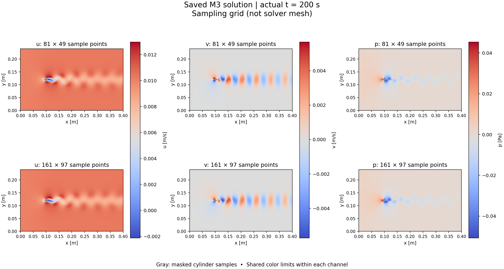

# 已有 M3 解的全域 u/v/p 小样采样

本轮采样验收通过。使用已有 M3 保存解，完成五个时刻、两种规则采样网格的导出、NPZ 读回、真实单位回读及同坐标同时刻直接求值核对。没有重新求解 CFD、修改求解网格、注入扰动或新增时间步研究。这里验证的是采样数据契约与同一离散解的一致性，不是全域真实误差保证。

## 结果与入口

| 项目 | 81×49 | 161×97 |
|---|---:|---:|
| 张量形状 `(T,3,Ny,Nx)` | `(5,3,49,81)` | `(5,3,97,161)` |
| x/y 采样间距 | 0.005 m | 0.0025 m |
| 每个时刻原始坐标行数 | 3969 | 15617 |
| 圆柱掩码点数，包含圆周 | 5 | 13 |
| 每个时刻原始无效点数 | 1 | 9 |
| 独立 EvalPoint 时空点数 | 15 | 15 |
| u/v/p 最大直接求值绝对差 | 0 / 0 / 0 | 0 / 0 / 0 |
| NPZ 写入后读回 | 通过 | 通过 |

请求和实际使用的保存时刻均为 **180、185、190、195、200 s**。实际保存解编号为 **901、926、951、976、1001**。独立审计重新解析全部十个原始 TXT，重建的全部张量与 NPZ 一致；两档采样网格的所有共同流体坐标也一致。

- [完整原生样例 ZIP](evidence/m3_field_sampling_20261105/native_sample.zip)：18 个文件，包含十个原始 TXT、两组 NPZ、回读、元数据、采样报告和模型检查。
- [机器报告](evidence/m3_field_sampling_20261105/sample_report.json)、[独立数据审计](evidence/m3_field_sampling_20261105/sample_artifact_audit.json)、[历史文件审计](evidence/m3_field_sampling_20261105/inspection_audit.json)。
- [81×49 真实回读](evidence/m3_field_sampling_20261105/grid_81x49/bridge_response.json)、[161×97 真实回读](evidence/m3_field_sampling_20261105/grid_161x97/bridge_response.json)。
- [81×49 NPZ](evidence/m3_field_sampling_20261105/grid_81x49/field_sample.npz)、[161×97 NPZ](evidence/m3_field_sampling_20261105/grid_161x97/field_sample.npz)，同目录的 `metadata.json` 可直接配套读回。
- [81×49 COMSOL 采样日志](evidence/m3_field_sampling_20261105/grid_81x49/comsol_sampling.log)、[161×97 COMSOL 采样日志](evidence/m3_field_sampling_20261105/grid_161x97/comsol_sampling.log)。这是结果求值/导出日志；本轮没有新的 CFD 步进日志。
- [59 项定向测试](evidence/m3_field_sampling_20261105/sampling_tests_final2.log)、[完整离线回归](evidence/m3_field_sampling_20261105/offline_regression_final2.log)，同名 XML 和 `_execution.json` 保存测试清单、实际进程退出码和耗时。



## 坐标、时间、掩码和单位契约

范围为 `x∈[0,0.4] m`、`y∈[0,0.24] m`，两轴严格递增并包含两端点。COMSOL 几何实际包围盒的 x 上界读回为 `0.4000000000000001`，以 `1e-12 m` 绝对容差核对浮点表示。NPZ 的 `x`、`y` 是明确的一维数组；`values[t,c,iy,ix]` 对应 `times[t], y[iy], x[ix]`，通道顺序固定为 `[u,v,p]`，数据类型 float64。

时间先与 `sol1.getPVals()` 的全部 1001 个保存时刻逐一匹配，再按保存解编号选择。`requested_times` 和 `actual_times` 分别记录，绝对容差仅为 `1e-12 s`；不以最近时刻替换，不进行请求时刻间的插值。独立 EvalPoint 同时求值 `t` 检查实际使用时间。真实负例请求 `180,180.1,185 s`，在生成任何 TXT 前拒绝 `180.1 s`，见[原始错误回读](evidence/m3_field_sampling_20261105/negative_time_probe/bridge_response.json)和[执行记录](evidence/m3_field_sampling_20261105/negative_time_probe/negative_probe_result.json)。

圆柱来自实际几何特征 `comp1/geom1/c1`：中心 `(0.1,0.12) m`，半径 `0.005 m`。

- `cylinder_mask[Ny,Nx]`：距离 `r <= R + 1e-12 m`，明确包含圆柱边界。
- `invalid_mask[T,Ny,Nx]`：原始任一 u/v/p 非有限的坐标。所有原始无效点均位于圆柱内部；流体域无 NaN/Inf。
- `mask[T,Ny,Nx]`：上述两者的并集，True 表示无效。掩码内三个通道统一保存为 NaN，保留原始 TXT 以区别原始无效点与被主动屏蔽的圆周有限值；不填零。外边界仍参与采样。

实际单位来源如下，速度和压力单位均未在 Java 中主动设置：

```text
exp_fullfield_0..4 (Data)
  getStringArray("expr") → ["u","v","p"]
  getStringArray("unit") → ["m/s","m/s","Pa"]
  getString("data")      → dset1 (Solution) → sol1
  getString("innerinput")→ manual
  getIntArray("solnum")  → [901] / [926] / [951] / [976] / [1001]

num_fullfield_check (EvalPoint)
  → cpt_fullfield_check (CutPoint2D) → dset1 → sol1
  expressions → [u,v,p,x,y,t]
  units       → [m/s,m/s,Pa,m,m,s]
```

各导出节点在 `run()` 后读取表达式、实际解析单位、Dataset、解编号与网格数组；Python 同时检查原始 TXT 表头中的单位和时间。每个时刻分别在 `(0.05,0.12)`、`(0.15,0.12)`、`(0.30,0.18) m` 做独立求值，核对实际 x/y/t 与 u/v/p。值比较容差为 `atol=1e-10, rtol=1e-9`，实际所有差值均为 0。

## 来源与历史保护

源模型为 `runs/re100_s1b2_m3_20261105_verified/re100_s1b2_m3_solved.mph`。当前基线提交为 `19aea85a6f51d5c36ee2d71cfbbcb0e0136e5205`。源模型 SHA-256 在加载检查、真实导出、拒绝测试和独立最终审计中均保持：

```text
15e841fc4240d93db877932c1b371646426f1229bdb40d0335b0ed7609d145b4
```

Java 新入口仅 `loadCopy` 已有解、读取模型并创建临时结果节点，没有调用 study/solver/mesh/geometry 的求解或构建方法，也没有保存模型。正式运行入口总耗时约 70.82 s（包含模型检查、两次加载导出、校验和写盘），退出码 0。

独立审计冻结并复查 **646 个历史文件，0 个改变**，涵盖原始模型、既有阶段模型、A/B/C/D 与 M1/M2/M3 运行结果及既有证据。未更改 `.gitattributes`、既有可视化模块、统计公式或任何历史证据文件。

COMSOL 原始 TXT 使用 CRLF。`native_sample.zip` 保存运行目录的原始字节；[原生文件清单](evidence/m3_field_sampling_20261105/native_archive_manifest.json)记录 ZIP 与 18 个条目的 SHA-256，并逐个验证 ZIP 内容与运行文件相同。元数据中的 `raw_files` 哈希对应 ZIP 内的原始 TXT。仓库另附的 JSON/日志便于直接浏览，按既定文本规则规范为 LF；NPZ、ZIP、PNG 保持二进制字节。不要将文本展示副本的字节哈希误当作原始 ZIP 条目的字节哈希。

## 验证记录与边界

最终 **59 项采样定向测试通过**，覆盖正式 Python 入口、实际文件解析、NPZ 写入和读回；只在故障注入测试中替换外部 COMSOL 调用。正常集成证据来自本次真实已有 M3，而非模拟字典。

最终 **308 项完整离线回归通过、30 项标记为 integration 的测试未运行**。本轮遵守“不重新求解 CFD”，没有运行包含求解行为的旧集成测试，因此不将它表述为所有测试均执行。真实已有解采样、时间拒绝、独立原始数据核对分别补充本轮集成证据。新增 Python 文件通过 Ruff 检查；源码和报告的 Git diff 检查通过。全量暂存区 diff 检查仍提示 COMSOL 原始进度日志及首次失败 traceback 的行尾空白；保留这些日志内容，未为消除格式提示修改执行证据。新证据清单内 46 个文件均与实际 Git 暂存 blob 哈希一致，ZIP、NPZ 和 PNG 字节保持。

保留两项执行过程说明：第一次最终定向测试为 58 通过、1 失败，失败是临时目录 `os.rename` 的 Windows `WinError 5`；未修改代码复测后 59 项通过，原始失败日志为 `sampling_tests_final.log`，未删除。真实负例的 Java 进程返回 0，但结构化 ERROR 被正式 Python 桥接映射为 `ModelValidationError`；探测脚本在证据保存后向 GBK 控制台打印含 emoji 路径时退出 1，执行记录明确区分该打印错误与真实拒绝结果。没有为取得更好记录而重复运行 COMSOL 负例。

没有未解决的采样契约阻断项。Windows 临时目录重命名曾出现一次失败，保留为运行环境风险；若再次发生，失败现场会保留，目标目录不会被静默覆盖。本轮止于五时刻小样，不扩展到全部 1001 时刻、未知扰动或新的数值精度研究。

## 复现入口

已有模型仍在本机时，使用一个**尚不存在的新目录**：

```powershell
python scripts/sample_re100_m3_fields.py --output runs/m3_field_sample_review
python -m pytest -v tests/test_full_field_sampling.py
python -m pytest -q -m "not integration"
```

仅核对数据无需启动 COMSOL。将 `native_sample.zip` 解压到新目录后：

```powershell
python docs/evidence/m3_field_sampling_20261105/sample_artifact_audit.py --sample-dir <解压目录> --output <新审计JSON路径>
```

独立审计脚本不导入生产采样/解析 helper。若异地缺少大体积 `.mph`，会明确记录 `physical_model_bytes_checked=false`，不能声称重新核对了源模型字节。本机归档审计该字段为 true。

直接读回单个网格：

```python
from hydro_disturb_bench.field_sampling import load_full_field_sample
data = load_full_field_sample("docs/evidence/m3_field_sampling_20261105/grid_161x97")
uvp = data["values"]       # (5, 3, 97, 161)
invalid = data["mask"]     # True 表示无效
x, y, t = data["x"], data["y"], data["times"]
```
