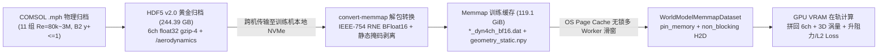

# 3D CFD 世界模型 GPU 训练数据流与 Memmap/BFloat16 工程规范

本文档固化 **HydroDisturb-Bench** 从高保真三维瞬态 CFD 黄金 HDF5 归档到 GPU 训练服务器零拷贝高速读取的完整数据工程流水线，覆盖数据契约、格式转换、`BFloat16` 与静态几何去冗余、PyTorch 多进程预取以及 GPU 端在轨物理监督（涡量 Sobolev $H^1$ 与 `/aerodynamics` Field-to-Force）。

---

## 一、 端到端数据链路架构



---

## 二、 黄金归档契约 (`WorldModel-CFD-v2.0-SOTA`)

11 组高雷诺数黄金工况（总计 **13,552 时步 / 244.39 GB**）采用 Chunked HDF5 (`(1, 6, 64, 96, 192)`, `float32`, `gzip-4`) 归档，包含三层完备信息：

1. **核心时空场张量** (`/flow_fields`, `/coordinates`, `/time_physical_s`, `/time_nondim_ctu`, `/step_indices`)：
   - 通道：`[u*, v_cross*, w_span*, p*, sdf*, solid_mask]`，均匀笛卡尔网格步长 $\Delta x^* = \Delta y^* = \Delta z^* = 0.0625$（即 $D/16$，$D=0.30\,\text{m}$）；
   - 物理约束：圆柱内部严格清零且 `solid_mask = 1`，流体域严格零 NaN/Inf。
2. **高精度边界积分气动力组** (`/aerodynamics`)：
   - 高频时序 `time_physical_s`、`time_nondim_ctu`、`cd`、 `cl`、`drag_force_n`、`lift_force_n`；
   - 组属性固化宏观指标：`strouhal_number`、 `cd_mean`、 `cl_rms`、`cl_amplitude_mean`。
3. **相态与求解器根属性** (`attrs`)：
   - `transient_startup_ctu` 与 `stationary_vortex_shedding_ctu`：显式区分静止启动过渡期与统计平稳卡门涡街极限环；
   - `solver_scheme`、`relative_tolerance`（`0.0005`）、`mesh_tetrahedral_elements`（`680000`）、`interpolation_kernel`。

---

## 三、 GPU 训练 I/O 瓶颈与 3+1 优化矩阵

对原版 `gzip-4` 归档直接随机抽帧的实机基线测试（`c04_golden_wm_full_trajectory.h5`）显示，随机读 10 帧仅 **127.3 MB/s（212.0 ms/帧）**——主要受 **CPU `gzip` 解压** 与 **HDF5 文件读取锁** 限制。为彻底消除 GPU 算力饥饿，训练机侧实施以下 4 项核心优化：

| 优化维度 | 实现机制 | 存储与带宽收益 |
| --- | --- | --- |
| **1. 零拷贝 `np.memmap`** | 解包为无压缩连续二进制 `.dat` 文件，利用操作系统 Page Cache + 只读 `np.memmap` | 消除 `gzip` CPU 解压与 HDF5 多进程锁 |
| **2. 静态几何剥离** | 全工况实测 `sdf_star` 与 `solid_mask` 完全一致，仅存 1 份 `geometry_static.npy` (`3.0 MiB`) | 单帧读取体量从 `27.0 MiB` 降至 `18.0 MiB`（**-33.3%**） |
| **3. `BFloat16` 混合精度** | IEEE-754 Round-to-Nearest-Even 舍入至 `bfloat16`（保持 8 位指数域，防高 $Re$ 溢出） | 单帧体量再减半至 **`9.0 MiB/帧`**（全量 13,552 帧仅 **119.1 GiB**，总降幅 **3×**） |
| **4. 异步 GPU 预取与在轨算子** | `pin_memory=True` + `persistent_workers=True` + `non_blocking=True` + GPU 算涡量 | 磁盘零冗余涡量存储，H2D 拷贝与计算重叠 |

> [!IMPORTANT]
> **工程选址纪律**：解压转换应在具备直连本地 NVMe SSD 与足够空间（推荐 $\ge 400\,\text{GiB}$）的 **GPU 训练服务器** 上执行；跨机传输阶段始终搬运压缩后的 `244.39 GB` 黄金 HDF5 归档，切勿在普通网络盘（NAS/NFS）上挂载 `Memmap`。

---

## 四、 标准化 CLI 与 Python 代码接口

模块分别固化在 [`hydro_disturb_bench.memmap_cache`](../src/hydro_disturb_bench/memmap_cache.py) 与 [`hydro_disturb_bench.world_model_dataloader`](../src/hydro_disturb_bench/world_model_dataloader.py)，并通过 `hydrobench` CLI 暴露：

### 1. CLI 一键转换与压测

```bash
# 在训练服务器本地 NVMe 上转换 11 组 HDF5 -> 4ch BFloat16 Memmap
hydrobench convert-memmap \
  --input-dir /data/cfd_world_model/h5_archive \
  --output-dir /data/cfd_world_model/memmap_bf16 \
  --dtype bf16 --workers 4 --verify --benchmark

# 压测裸盘 Memmap 与完整 PyTorch GPU DataLoader H2D 链路
hydrobench benchmark-memmap \
  --cache-dir /data/cfd_world_model/memmap_bf16 \
  --gpu-loader --batch-size 4 --num-workers 8 --max-batches 50
```

> 若训练机未安装完整 `HydroDisturb-Bench` 包，可直接使用自包含独立脚本 `convert_h5_to_memmap_cache.py` 与 `world_model_dataloader.py`。

### 2. PyTorch 训练接入契约

```python
import torch
from hydro_disturb_bench.world_model_dataloader import (
    attach_static_geometry_gpu,
    compute_vorticity_3d_gpu,
    create_memmap_dataloader,
)

device = torch.device("cuda")
ds, loader = create_memmap_dataloader(
    cache_dir="/data/cfd_world_model/memmap_bf16",
    batch_size=4,
    context_len=4,
    pred_len=4,
    stride=1,
    regime="stationary",  # 自动依据 stationary_vortex_shedding_ctu 裁掉启动过渡期
    num_workers=8,
    prefetch_factor=4,
    return_bf16=True,
)
static_geom_gpu = ds.get_static_geometry_tensor(device=device, dtype=torch.bfloat16)

for batch in loader:
    x_4ch = batch["x_ctx"].to(device, non_blocking=True)   # (B, T_ctx, 4, 64, 96, 192)
    y_4ch = batch["y_fut"].to(device, non_blocking=True)   # (B, T_fut, 4, 64, 96, 192)
    cond = batch["cond"].to(device, non_blocking=True)     # (B, 3): [log10(Re), U0, D]
    cd_gt = batch["cd"].to(device, non_blocking=True)      # (B, T_ctx + T_fut)
    cl_gt = batch["cl"].to(device, non_blocking=True)

    # 显存内零 I/O 拼回 6 通道 [u*, v*, w*, p*, sdf*, solid_mask]
    x_6ch = attach_static_geometry_gpu(x_4ch, static_geom_gpu)
    # 显存内计算 3D 涡量用于 Sobolev H1 损失，无需硬盘额外存储
    omega_gt = compute_vorticity_3d_gpu(y_4ch[:, :, :3].float(), ds.grid_spacing_star)
```

---

## 五、 物理监督与科学防泄漏边界

1. **条件向量统一契约**：所有 3D 世界模型统一传入 $\mathbf{c} = [\log_{10}(Re), U_0, D] \in \mathbb{R}^3$，确保跨 $8\times 10^4 \sim 3\times 10^6$ 雷诺数量级的条件泛化语义一致。
2. **相态分离与防时间泄漏**：`regime="stationary"` 强制截断至稳态脱落起始步之后；跨模型泛化评测必须按工况/雷诺数轨迹族整条留出（如留出 $Re=180\text{k}$ 或 $Re=350\text{k}$），禁止将同一连续轨迹的相邻滑窗拆入训练与测试两侧。
3. **质量门禁**：转换端 `--verify` 自动抽检 `[0, T//2, T-1]` 相对误差（`bf16 <= 1.5e-2`，`fp32 <= 1e-6`）与全帧有限性；离线无外部数据 CI 通过 `pytest tests/test_memmap_training_pipeline.py` 回归覆盖核心舍入算法、索引切窗、静/动通道拼接与 CLI 解析。
