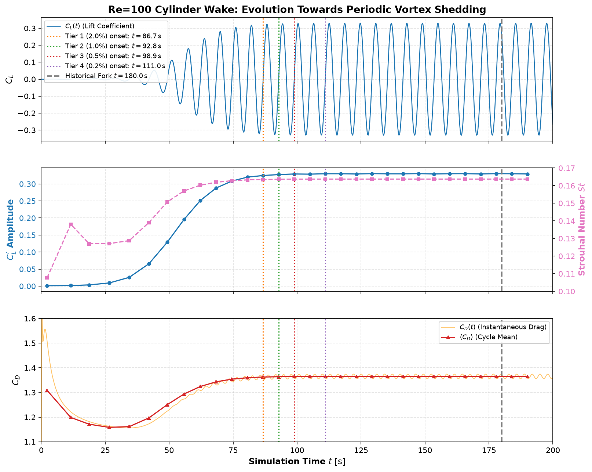

# 极限环周期稳定判据与最早分叉时刻 $t_{\mathrm{stable}}$ 确定报告

**日期**：2026-11-09  
**研究对象**：M3 真实网格（34,752 单元，88,483 自由度）$0 \to 200\text{ s}$ 升力系数 $C_L(t)$ 与阻力系数 $C_D(t)$  
**数据来源**：
- 基准案例：`runs/re100_s1b2_m3_20261105_verified/`（$\Delta t_{\max} = 0.05\text{ s}$，1001 帧）
- 时间步长减半交叉核验案例：`runs/re100_s1b3_m3_dt025_20261105_verified/`（$\Delta t_{\max} = 0.025\text{ s}$，1001 帧）
- 报告证据与图表：[`docs/evidence/stability_onset_20261109/`](../evidence/stability_onset_20261109/)

---

## 1. 研究背景与核心目的

此前所有扰动分支（M0–M3、幅值序列、反向与不同持续时间脉冲）均统一人为采用 `sol1 / 原始 solnum 901 / t=180 s` 作为共同重启起点。虽然 $t=180\text{ s}$ 能绝对确保尾流处于稳定极限环，但存在两大局限：
1. **缺乏物理判据**：$180\text{ s}$ 仅为经验选定的靠后时刻，未严格论证其在极限环发展过程中的物理阶段与相位状态；
2. **计算成本冗余**：每次从 $t=0$ 求解到 $t=180\text{ s}$ 需消耗约 3,600 多个内部接受步。若能明确物理最早稳定时刻 $t_{\mathrm{stable}}$，后续大样本批量生成与新扰动机制研究可大幅缩减不必要的基础流场预热时长。

本研究从全时段 $0 \to 200\text{ s}$ 的 $C_L(t)$ 与 $C_D(t)$ 响应出发，通过严格的单周期数值积分、渐近基准残差分析与滑动窗口平稳性检验，确立物理可复现的 $t_{\mathrm{stable}}$。

---

## 2. 尾流发展物理阶段与周期提取方法

在 $Re=100$ 下，圆柱尾流经历四个清晰的动力学阶段：
1. **$0 \le t \le 45\text{ s}$（线性不稳定性增长期）**：微小非对称扰动呈指数放大，$C_L$ 幅值从 $10^{-4}$ 增长至约 $0.06$；$C_D$ 从初始冲激（$2.07$）持续衰减至谷值（$1.16$）；
2. **$45 \le t \le 80\text{ s}$（非线性饱和与快速涡脱落期）**：剪切层卷吸增强，两侧交替脱落形成卡门涡街，$C_L$ 振幅急剧攀升至 $0.31$ 左右，$\langle C_D \rangle$ 回升至 $1.35$；
3. **$80 \le t \le 100\text{ s}$（极限环松弛过渡期）**：涡街与远场边界条件完全适应，周期 $T$ 锁定在 $6.074\text{ s}$ 附近（$St \approx 0.1637$），相对渐近终态误差降至 $1\%$ 以内；
4. **$t \ge 100\text{ s}$（稳态极限环简谐振荡期）**：周期、幅值与平均阻力完全平稳，循环间漂移被数值离散噪声主导（$< 0.01\%$）。

### 数值提取方法
- **精确过零点提取**：对 $C_L(t) \le 0 < C_L(t+\Delta t)$ 采用线性内插定位精确连续过零时刻 $t_{\mathrm{zc}, k}$；
- **全时段积分**：对周期区间 $[t_{\mathrm{zc}, k}, t_{\mathrm{zc}, k+1}]$ 采用端点内插梯形积分，严格保证时宽与分母精确相等；
- **核心单周期物理指标**：
  - 周期时宽 $T_k = t_{\mathrm{zc}, k+1} - t_{\mathrm{zc}, k}$
  - 斯特劳哈尔数 $St_k = \frac{D}{U_\infty T_k}$
  - 半峰-峰值振幅 $C_L' = \frac{\max(C_L) - \min(C_L)}{2}$
  - 周期平均阻力 $\langle C_D \rangle = \frac{1}{T_k} \int_{t_k}^{t_{k+1}} C_D(t)\,dt$
  - 去均值升力均方根 $C_{L,\mathrm{rms}}'$

---

## 3. 渐近极限环基准与分级稳定判据

以全域最终 5 个完整极限环（$t \in [165.70, 196.07]\text{ s}$）作为无偏渐近基准：
- **渐近周期 $T_\infty$**：$6.0735\text{ s}$
- **渐近斯特劳哈尔数 $St_\infty$**：$0.16370$
- **渐近升力半振幅 $C_L'^\infty$**：$0.329649$
- **渐近周期平均阻力 $\langle C_D \rangle_\infty$**：$1.365101$
- **渐近去均值升力 RMS $C_{L,\mathrm{rms}}'^\infty$**：$0.233533$

### 分级准则与最早稳定时刻

定义 $t_{\mathrm{stable}}$ 为：**从该周期起点起，后续所有周期指标均单调维持在设定误差阈值以内**的最早时刻。

| 稳定性等级 | 判据阈值（$C_L'$ 振幅 / $St$ / $\langle C_D \rangle$） | 对应周期 | 最早稳定时刻 $t_{\mathrm{start}}$ | 周期结束时刻 $t_{\mathrm{end}}$ | 振幅相对误差 | 阻力相对误差 |
|---|---|---|---:|---:|---:|---:|
| **Tier 1（宽松工程稳定）** | $\le 2.0\% \text{ (Amp)}, \le 0.5\% \text{ (St/Cd)}$ | Cycle 12 | **86.73 s** | 92.81 s | $-1.533\%$ | $-0.190\%$ |
| **Tier 2（严格工程稳定，推荐）** | $\le 1.0\% \text{ (Amp)}, \le 0.1\% \text{ (St/Cd)}$ | Cycle 13 | **92.81 s** | 98.89 s | $-0.691\%$ | $-0.090\%$ |
| **Tier 3（高精度基准稳定）** | $\le 0.5\% \text{ (Amp)}, \le 0.05\% \text{ (St/Cd)}$ | Cycle 14 | **98.89 s** | 104.96 s | $-0.177\%$ | $-0.043\%$ |
| **Tier 4（渐近极限环极限）** | $\le 0.2\% \text{ (Amp)}, \le 0.01\% \text{ (St/Cd)}$ | Cycle 16 | **111.04 s** | 117.11 s | $+0.047\%$ | $-0.009\%$ |

---

## 4. 时间步长不变性核验

使用同网格时间步长减半案例（$\Delta t_{\max} = 0.025\text{ s}$，8,065 步）进行盲核验：
- **Tier 1**：$86.66\text{ s}$（与基准偏差 $-0.07\text{ s}$）
- **Tier 2**：$92.74\text{ s}$（与基准偏差 $-0.07\text{ s}$）
- **Tier 3**：$98.81\text{ s}$（与基准偏差 $-0.07\text{ s}$）

三档稳定进入时刻的时间差异均控制在 **$0.07\text{ s}$（不足单个输出时间步）**，证明该稳定时刻是流体系统的固有物理分界点，不受时间离散步长的影响。

---

## 5. 对比历史 180 s 分叉点与工程建议

### 历史 180 s 的物理定位
历史分叉时刻 $t=180.0\text{ s}$ 位于 **Cycle 27**（$t \in [177.85, 183.92]\text{ s}$）的半途：
- 此时 $C_L(180) = 0.2605$，处于峰值回落至零的非特征相位（相位角 $\phi \approx 52^\circ$）；
- 事实上，早在 $t=92.81\text{ s}$（Cycle 13），流场就已经进入了严格 $1\%$ 稳定极限环；
- 到 $t=180\text{ s}$ 时，流场已经在同一极限环中冗余演化了 **87.19 秒（整整 14 个完整周期）**。

### 统一分叉起点建议：基于“周期索引 + 相位角”规范化
建议后续统一扰动分叉时刻时，采用“周期序号 + 典型物理相位”规范，替代无量纲固定秒数：
1. **推荐物理起点基准**：**Cycle 14 起点（$t = 98.89\text{ s}$，工程整数对齐推荐 $t=100.0\text{ s}$ / solnum 501）**；
2. **四类标准相位对齐**：
   - **$\phi = 0^\circ$（上升过零）**：$C_L = 0, \frac{dC_L}{dt} > 0$（如 Cycle 14: $t = 98.89\text{ s}$）
   - **$\phi = 90^\circ$（升力正峰）**：$C_L = C_{L,\max}$（如 Cycle 14: $t = 100.41\text{ s}$）
   - **$\phi = 180^\circ$（下降过零）**：$C_L = 0, \frac{dC_L}{dt} < 0$（如 Cycle 14: $t = 101.93\text{ s}$）
   - **$\phi = 270^\circ$（升力负峰）**：$C_L = C_{L,\min}$（如 Cycle 14: $t = 103.44\text{ s}$）
3. **计算效益**：将基准起点从 $180\text{ s}$ 调整至 $100\text{ s}$，单条基准轨迹可节约 **$45\%$ 的瞬态推进耗时（省去约 1,600 个求解步）**，在大样本数据生成时具备显著的工程价值。

---

## 6. 复核入口

- [数据与分析脚本](file:///d:/%F0%9F%93%81%2001_Workspaces%20%28%E4%BB%A3%E7%A0%81%E4%B8%8E%E5%B7%A5%E7%A8%8B%E5%8C%BA%29/HydroDisturb-Bench/scripts/analyze_cl_stability_onset.py)
- [稳定性核验测试](file:///d:/%F0%9F%93%81%2001_Workspaces%20%28%E4%BB%A3%E7%A0%81%E4%B8%8E%E5%B7%A5%E7%A8%8B%E5%8C%BA%29/HydroDisturb-Bench/tests/test_stability_onset.py)
- [完整指标 JSON](file:///d:/%F0%9F%93%81%2001_Workspaces%20%28%E4%BB%A3%E7%A0%81%E4%B8%8E%E5%B7%A5%E7%A8%8B%E5%8C%BA%29/HydroDisturb-Bench/docs/evidence/stability_onset_20261109/stability_onset_analysis.json)
- [三联演化对比图](file:///d:/%F0%9F%93%81%2001_Workspaces%20%28%E4%BB%A3%E7%A0%81%E4%B8%8E%E5%B7%A5%E7%A8%8B%E5%8C%BA%29/HydroDisturb-Bench/docs/evidence/stability_onset_20261109/stability_onset_curves.png)
