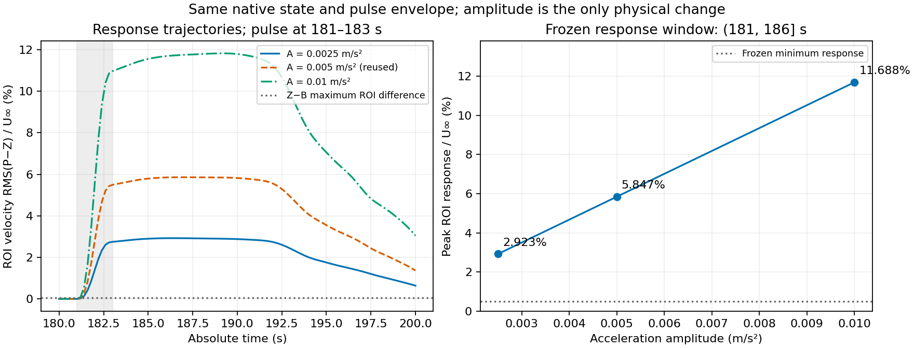

# M3 局部体力脉冲幅值系列（2026-11-06，PASS）

本轮数值验收 **PASS**。两个新增幅值均完成真实 COMSOL 求解、全域采样及原生来源、源项积分、步进和场比较核验；既有零分支与 `0.005 m/s²` 分支直接复用。完整入口返回 0，整组操作墙钟时间 817.993 s。报告写成时等待 Git 提交，最终提交及 push 状态由交付回复注明。

本轮基于已验收提交 `1f4d74e68b05c29d2ab62d3bb7486f54b22136dd`，只增加两个脉冲幅值。既有 M3 无扰动连续轨迹、零分支及 `0.005 m/s²` 分支直接复用；不重算旧解，不改变网格、扰动位置或时间包络。

| 算例 | 加速度幅值 A（m/s²） | 本轮处理 | 最终状态 |
| --- | ---: | --- | --- |
| Z0 | 0 | 复用已验收零分支，核对冻结模型与证据身份 | PASS，未重算 |
| a0025 | 0.0025 | 新建独立分支并求解、采样 | PASS |
| a0050 | 0.005 | 复用已验收脉冲分支及其原报告 | PASS，未重算 |
| a0100 | 0.010 | 新建独立分支并求解、采样 | PASS |

新增幅值由[本轮独立冻结计划](../evidence/m3_pulse_amplitude_series_20261106/preregistered_plan.json)授权，系列标识为 `m3-pulse-amplitude-series-v1`。计划 SHA-256 为 `75b08df846652372f7c01a1e8699f67cf57912c44b45b719135d701b7f8c4f8d`；[冻结记录](../evidence/m3_pulse_amplitude_series_20261106/plan_freeze_record.json)记载写入时尚未开始本系列 Time 求解，并已核对 21 个旧文件。

旧物理计划（SHA-256 `72343d29335f761b82a5c3aa5b269b027fca82217c6cb69adbd537e8787125ad`）和旧重启协议（SHA-256 `586a7065a7e9da4560501a368ab68037b0bbdaebf4957e6bab9541bb16e8acb8`）保持原字节。旧协议提供相同的重启方法；新增幅值的授权来自本轮计划。派生计算计划只更改 A，以及随 `A/0.005` 缩放的峰值力密度、峰值单位厚度合力和单位厚度冲量三个源项参考值；高斯面积、积分容差及所有场比较门槛不变。

所有分支使用同一 M3 模型在绝对时刻 `180 s` 的原生保存解：`sol1` 第 `901` 个保存时刻、`88,483` 个原生自由度。共同 checkpoint 来自 COMSOL 原生解复制，保留 U 和 UDot，不能用规则网格采样张量替代。这里复用的是原生初始状态，**不声称恢复了原连续计算的 BDF 内部步进历史**；BDF 重新起步，Variables 探测与 Time 首帧的实际差值分别保留。

| 保持项 | 冻结设置 |
| --- | --- |
| 输出时刻 | 180–200 s，每 0.2 s，共 101 帧 |
| 场数据 | 161×97 规则网格，`(T,3,Ny,Nx)`，通道 `[u,v,p]`，沿用掩码和单位契约 |
| 时间设置 | `rtol=1e-4`，`maxstepconstraintbdf=const`，`maxstepbdf=0.05 s` |
| 重启协议 | `native-restart-consistent-off-v2`，`consistent=off` |
| 空间脉冲 | 中心 `(0.15,0.12) m`，σ=0.01 m，方向 `[0,1]` |
| 时间脉冲 | 181–183 s 内使用原紧支撑 sin² 包络，窗外为零 |
| 施力单位 | 加速度 A 经实际 `rho_f` 换算为体力密度 `N/m³`；COMSOL 节点、单位及积分回读已通过核验 |

比较沿用原方法：用同一无扰动连续轨迹检查 Z0 的重启误差，用每个脉冲分支减 Z0 检查响应。速度采用面积加权向量 RMS；压力分别扣除每帧空间加权均值，同时保留原压力均值偏移。ROI 为 `[0.12,0.25]×[0.08,0.16] m`。

重启门槛仍为速度时间 RMS/U≤0.005、逐帧最大 RMS/U≤0.01，去均值压力时间 RMS/(ρU²)≤0.01、逐帧最大值≤0.03。事件前 `t≤181 s` 的 ROI 响应不得超过 `max(0.0001, 2×同一事件前窗口零分支 ROI 误差峰值)`；`181<t≤186 s` 的响应峰值须达到 `max(0.005, 5×零分支全时窗 ROI 误差峰值)`。不根据本轮结果提高幅值或放宽门槛。

| 指标 | a0025 | a0050（复用） | a0100 |
| --- | --- | --- | --- |
| 事件前 ROI 响应峰值/U | 2.57893382e−7 | 5.15785886e−7 | 1.03156890e−6 |
| 事件前允许界限 | 2.47527124e−4 | 2.47527124e−4 | 2.47527124e−4 |
| `(181,186] s` 内 ROI 峰值/U | 0.029228866785 | 0.058471570695 | 0.116883840333 |
| 窗口峰值时刻（s） | 186.0 | 186.0 | 186.0 |
| 窗口峰值/零分支噪声峰值 | 55.505409 | 111.037095 | 221.961577 |
| 窗口峰值/幅值 A | 11.691546714 | 11.694314139 | 11.688384033 |
| 幅值相对 a0050 的倍数 | 0.5 | 1 | 2 |
| 响应峰值相对 a0050 的倍数 | 0.499881676468 | 1 | 1.998985813834 |
| 原生来源、单位、场比较与步进门 | PASS | 已有结果复用，身份复核 PASS | PASS |

三档共用的零分支全时窗 ROI 噪声峰值为 `0.0005265949268222256`，实际检测门槛均为 `0.005`。**三个峰值都落在评价窗右端点 186 s，只表示预注册 `(181,186] s` 窗口内最大值，不是完整 180–200 s 轨迹的全局峰值。** 本次三档窗口指标随幅值增大，响应倍数接近幅值倍数；这只是描述性结果，不构成一般线性规律、其他幅值上的单调保证或全域真实误差保证。

| 实际源项与执行记录 | a0025 | a0050（复用） | a0100 |
| --- | ---: | ---: | ---: |
| 峰值力密度（N/m³） | 2.4955 | 4.991 | 9.982 |
| 峰值单位厚度合力（N/m） | 0.00156796752764623 | 0.00313593505529246 | 0.00627187011058493 |
| 单位厚度冲量（N·s/m） | 0.00156796752764623 | 0.00313593505529246 | 0.00627187011058493 |
| 合力/冲量相对参考差（无量纲，约） | 2.36054e−10 | 2.36054e−10 | 2.36054e−10 |
| 实际接受内部步数 | 457 | 457 | 457 |
| 最小 / 最大内部步长（s） | 0.00096408 / 0.05 | 0.00096408 / 0.05 | 0.00096408 / 0.05 |
| 最后内部时刻（s） | 200 | 200 | 200 |
| 单分支操作墙钟时间（s） | 196.661 | 110.741（历史执行） | 144.633 |

步数均为连续编号 1–457，排除了 101 条输出时刻记录。表中耗时来自 `execution.json.elapsed_seconds`，包含启动、求解、保存和证据处理等整次操作，不是独立的 COMSOL Time 求解器性能基准；旧 a0050 的历史耗时也不能用作本轮同条件性能对照。源项合力与冲量来自真实回读，独立提取时再次按其原生时间序列计算；它们是施加源项的积分，不等于含边界力与通量后的流体净动量变化。

每档保存张量 `(101,3,97,161)`，各有 303 个点×时刻直接求值核对（909 个通道值），三通道最大绝对差均为 0；每档流体通道条目 4,728,012，掩码 NaN 条目 3,939。新增两档合计 606 个点×时刻核对。完整未四舍五入数字、模型哈希及数据来源见[三档指标 JSON](../evidence/m3_pulse_amplitude_series_20261106/series_metrics.json)；其提取复核了窗口选取与源项积分，没有另行重算全场积分或重新读取 MPH 哈希。

两份新模型的执行记录 SHA-256 为：a0025 `731396d357dbd697b106db0522f53f0122f68a676eeed6c50d682b41d21c2e7a`；a0100 `a391acddd555dc448c59dfc0b9d3df827ff26800c5c379a405b45acfa5a6fe67`。共同 checkpoint 为 `7d052c545ce0428682a905d407e69cbe466984456d99dc9e72730728c646cf8c`。



本轮首次真实前置核验 [`precheck_01`](../evidence/m3_pulse_amplitude_series_20261106/logs/precheck_01/stderr.txt) 在任何新 Time 求解前停止。原因是正式采样 manifest 的 SHA-256 使用大写十六进制，而执行记录使用小写，新入口直接比较字符串导致误拒绝。修复先严格验证 64 位十六进制，再按同一摘要比较；绝对模型路径、模型字节身份、单位与采样契约均未放宽。原失败记录保留。修复后的 [`precheck_02`](../evidence/m3_pulse_amplitude_series_20261106/logs/precheck_02/stdout.txt) 已由真实 loader、原生证据和来源门核验通过，随后才执行本轮两个新 Time 分支。

实际回读及步进证据入口如下：

| 证据 | a0025 | a0100 |
| --- | --- | --- |
| COMSOL 真实回读摘要 | [回读摘要](../evidence/m3_pulse_amplitude_series_20261106/a0025_readback_summary.json) | [回读摘要](../evidence/m3_pulse_amplitude_series_20261106/a0100_readback_summary.json) |
| 实际完整步进日志（JSON 返回前的 stdout） | [步进日志](../evidence/m3_pulse_amplitude_series_20261106/a0025_solver_stdout.txt) | [步进日志](../evidence/m3_pulse_amplitude_series_20261106/a0100_solver_stdout.txt) |
| 系列计划与实施代码绑定 | [系列执行记录](../evidence/m3_pulse_amplitude_series_20261106/a0025_series_execution_summary.json) | [系列执行记录](../evidence/m3_pulse_amplitude_series_20261106/a0100_series_execution_summary.json) |
| 原生状态及源积分核验 | [原生核验](../evidence/m3_pulse_amplitude_series_20261106/analysis/a0025/native_validation.json) | [原生核验](../evidence/m3_pulse_amplitude_series_20261106/analysis/a0100/native_validation.json) |
| 场指标与步进判定 | [场比较](../evidence/m3_pulse_amplitude_series_20261106/analysis/a0025/field_comparison.json) · [步进核验](../evidence/m3_pulse_amplitude_series_20261106/analysis/a0025/step_validation.json) | [场比较](../evidence/m3_pulse_amplitude_series_20261106/analysis/a0100/field_comparison.json) · [步进核验](../evidence/m3_pulse_amplitude_series_20261106/analysis/a0100/step_validation.json) |

汇总入口为[系列结果](../evidence/m3_pulse_amplitude_series_20261106/analysis/report.json)及[轻量交付清单](../evidence/m3_pulse_amplitude_series_20261106/lightweight_export_manifest.json)。[最终引用文件核验](../evidence/m3_pulse_amplitude_series_20261106/reference_integrity_after.json)确认冻结的 21 个模型与旧证据文件哈希全部未变。

入口定向测试为 [53 passed in 18.54s](../evidence/m3_pulse_amplitude_series_20261106/logs/entrypoint_tests_final/stdout.txt)。**远程同步前**的完整离线回归为 [514 passed, 30 deselected in 98.55s](../evidence/m3_pulse_amplitude_series_20261106/logs/offline_regression/stdout.txt)，30 项 integration 测试未计入通过数；本轮真实 COMSOL 两分支核验另以上述证据记录。首次离线回归因独立 worktree 缺少历史测试产物，结果为 [29 failed, 485 passed, 30 deselected in 103.60s](../evidence/m3_pulse_amplitude_series_20261106/logs/offline_regression_initial_failure/stdout.txt)，原始失败日志保留，补齐测试产物访问后才得到通过记录。既往 P2 `WinError5` 本轮未遇到，不宣称已修复。

计算期间，远程 `main` 前进到 `f04323990cd649b846fd4fe8b70cc6235ec9d4b8`（PR 2/3，包含 IO 与 `field_sampling._cylinder_mask` 广播优化）。本轮实际 CFD 和采样使用的是 `1f4d74e` 基线加本轮实现，其工作字节快照已保留。交付代码已同步并保留这些远程改动；**同步后**完整离线回归为 [514 passed, 30 deselected in 57.03s](../evidence/m3_pulse_amplitude_series_20261106/logs/offline_regression_after_remote_sync/stdout.txt)，返回码 0。随后使用同步后的正式 loader、原生来源、步进及场比较函数重新读取两套新样本，生成的三类分析字典均与既有归档完全相等，21 个引用文件再次通过核验，见[同步后读回记录](../evidence/m3_pulse_amplitude_series_20261106/post_sync_validation.json)。该过程没有启动 COMSOL 或新增 Time 求解，原数值结果保持不变。

[实施源码绑定记录](../evidence/m3_pulse_amplitude_series_20261106/source_execution_binding.json)将实际运行工作字节与 Git 暂存字节逐项对应：新 runner 与冻结计划保持字节一致，旧 runner、bridge 与 Java 源码仅发生明确的 CRLF→LF 转换。两支执行期间的前后源码哈希一致；原工作字节和编译类保留在本地 `implementation_snapshot`。同步后的 checkout 可将工作文件恢复为 CRLF，因此同步后记录中的 runner 工作文件 SHA 与实际执行时的 LF 字节 SHA 不同；这一换行表示差异不代表 runner 逻辑更改，也不替代上述逐字节绑定。

复核已交付结果可在包含本轮提交的仓库中执行下列命令。它读取指定 Git 提交的实际 blob，检查清单、文件大小、冻结引用、摘要披露和求解日志结构，不要求本地大型产物，也不启动 CFD；它不重新验证全部原生向量或全场数值。`--git-ref` 可替换为本轮完整提交哈希，输出文件必须尚不存在。

```powershell
python .\docs\evidence\m3_pulse_amplitude_series_20261106\audit_delivery.py --git-ref HEAD --output .\amplitude_delivery_audit_01.json
```

仅在需要另建一次完整系列运行时，使用已配置项目依赖和 COMSOL 的环境，指定保有冻结模型、checkpoint 与旧结果的数据根目录，再选择尚不存在的新输出目录。以下 `all` 命令会实际求解两条新分支，不能作为无需重算的验收命令：

```powershell
$env:HYDRO_DATA_ROOT = 'D:\📁 01_Workspaces (代码与工程区)\HydroDisturb-Bench'
python .\scripts\run_m3_pulse_amplitude_series.py --output runs/re100_m3_pulse_amplitude_series_reproduction_01 --stage all
```

本轮采用轻量 Git 交付：代码、冻结配置、测试、紧凑回读摘要、求解和回归日志、指标及身份清单，每个入库文件不超过 1 MiB。MPH、原生向量、完整 TXT/NPZ 和大包标为 `local_only`，保留在 `HYDRO_DATA_ROOT` 指向的本地数据目录；摘要不是原始完整回读的替代品。代码与配置位于独立 checkout，数据目录通过环境变量明确指定，不能把新 worktree 误认作旧模型所在地。

本地原始运行目录共 392 个文件、3,757,405,452 字节；[本地文件身份清单](../evidence/m3_pulse_amplitude_series_20261106/local_artifact_inventory.json)记录实际逐文件读取所得的大小和 SHA-256，以及稳定的相对路径。它们保留在数据存储中，Git 只收录清单与上述必要证据。

独立备份当前为 `not_configured`：没有提供备份目的地，不声称已有远程完整数据备份，也不把它作为本轮数值通过的门禁。本轮规定的数值与来源门均通过，结论限于这三个幅值、冻结时窗和同一基线。尚未验证一般线性规律、其他扰动或全域真实误差；本轮不扩展网格、时间步、随机参数批次或训练任务。
