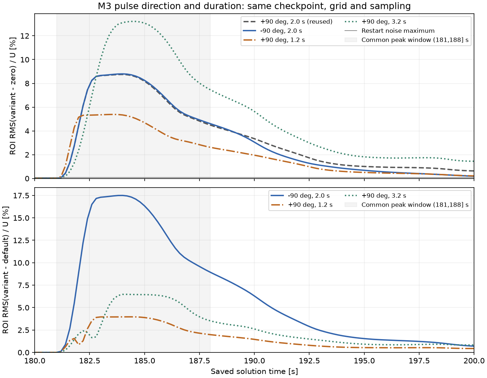

# M3 局部体力：反向与持续时间真实对照

日期：2026-11-09。三条新分支均完成真实 COMSOL 参数回读、续算、实际步进检查、101 帧采样与正式分析。复用已有正向 2 秒分支和零扰动分支，没有重算原有 A/B/C/D、M0–M3 或历史基线。

## 冻结范围与共同起点

共同原生起点为 `sol1 / 原始 solnum 901 / t=180 s`，checkpoint SHA-256 为 `7d052c545ce0428682a905d407e69cbe466984456d99dc9e72730728c646cf8c`。运行前先用 COMSOL 读取该模型节点；文件哈希前后不变。

位置 `(0.15,0.12) m`、加速度幅值 `0.005 m/s²`、高斯宽度 `σ=0.01 m`、开始时间 `181 s` 固定。幅值非负，反向由方向角指定。σ 是高斯宽度，不是硬截断半径。

| 分支 | 方向 | 起止时间 | 持续时间 | 数据来源 |
| --- | ---: | --- | ---: | --- |
| default | +90° | 181–183 s | 2.0 s | 已验收结果，只读复用 |
| reverse | −90° | 181–183 s | 2.0 s | 本次真实续算 |
| short | +90° | 181–182.2 s | 1.2 s | 本次真实续算 |
| long | +90° | 181–184.2 s | 3.2 s | 本次真实续算 |

M3 原生网格与 `native-restart-consistent-off-v2` 协议保持：`rtol=1e-4 / maxstepconstraintbdf=const / maxstepbdf=0.05 s / consistent=off`。从共同 checkpoint 加载，仅配置本次脉冲；原生 U/UDot、自由度、网格身份及可读节点快照参与核验，不声称恢复完整 BDF 内部历史或对所有材料/边界属性逐项独立枚举。

采样仍为 180–200 s、每 0.2 s、101 帧，`(101,3,97,161)`、`float64`、通道 `[u,v,p]`、单位 `[m/s,m/s,Pa]`；四批为 `32+32+32+5`。坐标、端点、时间选择、掩码和直接求值核对保持既有契约。

## 实际源项与求解日志

实际参数值和单位来自 COMSOL getter；真实 `local_theta` SI 值为弧度，另保留 declared-unit 角度。`VolumeForce` 表达式和三分量 `N/m³` 单位、Dataset/Solution、源项空间积分 `N/m` 均保留。

以下冲量由求解完成后 101 个实际保存时刻的源积分积分得到，单位为每单位厚度 `N·s/m`；它不是流体净动量变化。检查前的 `subst` 诊断单独标注为规定源项求值，不当作求解未来。

| 新分支 | 实际方向向量 | 实际 y 冲量 (N·s/m) | 相对独立参考误差 | 接受内部步数 | 最大内部步长 |
| --- | --- | ---: | ---: | ---: | ---: |
| reverse | `[0.0, -1.0]` | -0.00313593505529246 | 2.36054e-10 | 457 | 0.050 s |
| short | `[0.0, 1.0]` | 0.00188156103317545 | 2.36039e-10 | 457 | 0.050 s |
| long | `[0.0, 1.0]` | 0.00501749608846792 | 2.36049e-10 | 457 | 0.050 s |

步数来自原始进程 stdout 的完整 Step 表，排除 101 个输出行；COMSOL getter 没有完整 Step 表，未将其作为步进证据。归档日志截取 stdout 中 JSON 数据块之前的完整求解文本，明确记录原始文件哈希及 LF/行末空白转换；正式解析器与便携审计均重新检查步号连续、时间区间及步长上限。

## 同口径场响应对照

各分支首先保留原有独立验收门槛：ROI 为本次中心 ±3σ，窗口 `(on,off+3]`；重启差异、脉冲前一致性、响应至少达到 `max(0.005U,5×ROI 重启噪声)` 三类条件均须通过，没有根据结果放宽。

下表另外统一使用预注册 ROI `x∈[0.12,0.18], y∈[0.09,0.15] m` 与响应窗口 `(181,188] s`，重新读取四组场数据计算。默认分支也重算统计，没有直接复制历史幅值系列不同 ROI 的峰值。RMS 是速度向量的空间加权 RMS；噪声是同 ROI 的 Z−B 在完整 180–200 s 的最大值。

| 分支 | 窗口内峰值 ROI RMS(P−Z)/U | 峰值时刻 | 峰值/重启噪声 | 全时段全域速度 RMS(P−Z)/U |
| --- | ---: | ---: | ---: | ---: |
| default | 8.748257% | 184.0 s | 128.788 | 2.071929% |
| reverse | 8.794541% | 184.0 s | 129.469 | 1.906537% |
| short | 5.385937% | 183.6 s | 79.289 | 1.311179% |
| long | 13.207358% | 184.4 s | 194.432 | 2.910664% |

共同 ROI 重启噪声上限为 **0.0679277% U**。四案在该共同窗口也均通过场门槛；三条新分支在各自原窗口的正式分析均通过。

| 新分支减默认正向 2 秒分支 | 共同窗口峰值 ROI 速度 RMS/U | 全时段去空间均值压力 RMS/(ρU²) |
| --- | ---: | ---: |
| reverse−default | 17.499001% | 0.02073968 |
| short−default | 3.968145% | 0.007707558 |
| long−default | 6.474566% | 0.0092008702 |

源冲量随指定方向和持续时间变化，确认参数真正接入；不要求流场严格反号，也不据此宣称流场响应按冲量线性缩放。这里只验证当前共同起点和三组参数，不代表整个参数空间精度或未知机制泛化。四组仍属于同一个祖先轨迹族，未加入新的训练/验证/测试划分。



## 发布失败与恢复记录

reverse 的原 `all` 命令在全部采样完成且读回通过后，最终 `os.rename(stage, fields)` 遇到 `PermissionError: WinError 5`。原命令退出码 1、两层 failure、完整 staging 文件身份均保留。随后仅重试目录发布：先用正式 loader 核验，使用原发布锁且目标不得存在，移动前后逐一核对 **117 个文件**和 **7 组数组**；全部相同。恢复后正式 `analyze` 再次核对模型/采样来源并通过，退出码 0。没有重新求解或重新导出 reverse。

恢复记录与原脚本绑定哈希，`sample_execution` 明确标记恢复完成；这证明本次发布恢复成功，不宣称 Windows 偶发锁定的根因已修复。启动只读 checkpoint 检查时另有一次临时脚本不支持关键字的 Python TypeError，在调用 COMSOL 前发生；改用既有 run_command 接口后完成读取，记录在 checkpoint source_identity 中。

## 回归与历史保留

- 定向测试：`461 passed in 117.05s (0:01:57)`。
- 本机完整离线回归（`-m "not integration"`）：`1112 passed, 13 deselected in 201.89s (0:03:21)`。定向数量包含在回归中，不相加；被排除的真实 integration pytest 本轮未运行。
- 本轮测试以 `tests/` 最终日志为准；先前通过记录保留在 `tests_initial/`、`tests_before_log_selection_fix/` 和 `tests_before_native_json_copy/`，各轮不累计。归档审计覆盖比较结果与原始来源绑定、求解/测试日志目录分离，以及原生 CRLF 清单的真实 Git 字节核验。
- 三条真实 COMSOL 分支与采样是另行留证的集成执行，不用离线测试数量代替。
- 对运行前登记的 **824 个历史文件**复算哈希，全部保持不变，包括既有原生模型、引用结果和原证据文件。

## 轻量交付与复核入口

Git 仅包含配置、比较代码/测试、报告、紧凑节点回读、实际步进日志、指标与身份清单。`.mph`、原生向量、完整 TXT/NPZ 均留在独立新 run 目录，以 `storage=local_only`、大小和 SHA-256 定位。回读摘要逐项标明省略内容；哈希身份不等于远端已经复算原生向量或全部场数据。

部分小型原生清单使用 CRLF。其精确原字节保存在 `.json.raw` 文件，同名 `.json` 为 LF 阅读副本；转换记录同时绑定原始哈希和副本哈希。模型/采样执行记录中的原始文件哈希仍核对 `.raw` 字节，不改写为副本哈希。原模型与运行目录文件没有被规范化或改写。

- [冻结计划与参数](../evidence/m3_pulse_direction_duration_20261109/preregistered_plan.json)
- [共同指标与输入来源哈希](../evidence/m3_pulse_direction_duration_20261109/comparison.json)
- [参数回读、步进与逐案结果](../evidence/m3_pulse_direction_duration_20261109/cases/)
- [定向日志](../evidence/m3_pulse_direction_duration_20261109/tests/targeted_stdout.txt) · [完整离线日志](../evidence/m3_pulse_direction_duration_20261109/tests/regression_stdout.txt)
- [交付身份清单](../evidence/m3_pulse_direction_duration_20261109/delivery_manifest.json)

持有本地数据时，可用正式只读入口重算比较，不调用 COMSOL：

```powershell
python -X utf8 scripts/compare_m3_pulse_direction_duration.py --plan docs/evidence/m3_pulse_direction_duration_20261109/preregistered_plan.json --expected-sha256 639b73bbb8299e3d501c7df7126b3ac767f84295f38a64952fc1166763068f12 --output scratch/new_direction_duration_comparison.json
```

仅持有 Git 代码与证据时可审计固定提交（输出必须是新文件）：

```powershell
python -X utf8 docs/evidence/m3_pulse_direction_duration_20261109/audit_delivery.py --git-ref <本轮提交哈希> --output scratch/new_direction_duration_delivery_audit.json
```

便携审计核对真实 Git blob、跨文件来源、参数/单位、101 帧源积分、步进和测试日志；不启动 COMSOL，也不声称替代本地全量张量复算。CI 的 Windows/Linux 离线子集排除 integration 和 artifact；最终提交的 Actions 结果与提交链接在交付消息中给出。
