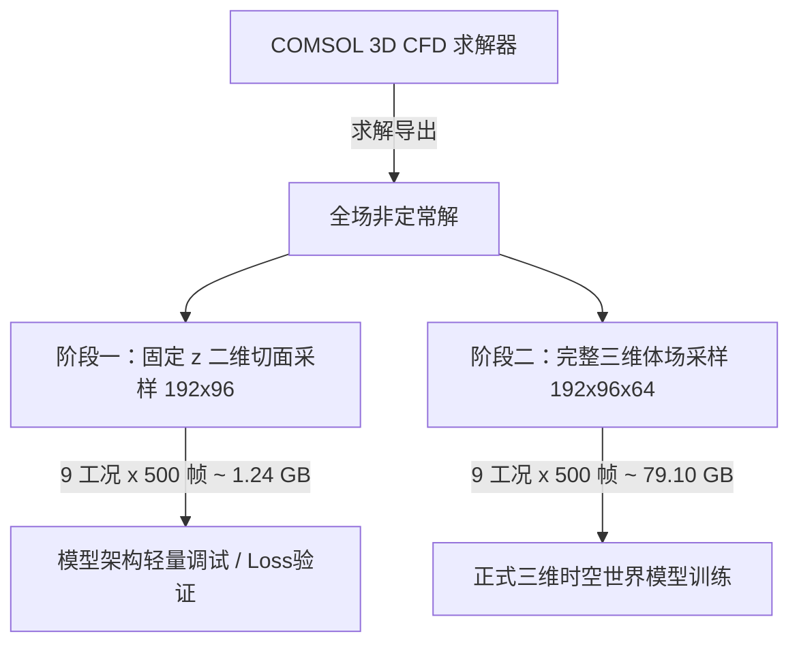

# COMSOL 三维单圆柱绕流：第一版参数核定与工程方案 (C04 工况)

本目录包含 **HydroDisturb-Bench** 三维圆柱绕流（3D Cylinder Flow）基准模型的参数规范、模型定义与世界模型（World Model）采样配置。

本方案在重新核对 **COMSOL 官方案例**、**ITTC 2024 海水物性表** 以及 **Lysenko (2025) Re=130,000 三维圆柱 LES 研究** 基础上，正式核定首个工程工况 **C04**。

> [!NOTE]
> **关于 `.mph` 大文件存储**：由于三维仿真求解二进制文件体积庞大（单网格解文件通常在 1.5GB ~ 20GB+），所有 `*.mph`、`*.mphbin`、`*.mph.lock` 均已被 [`.gitignore`](../../.gitignore) 忽略，不进入 Git 仓库版本追踪。

---

## 一、首组工程工况 C04：确定的物理参数

C04 为标准横向绕流（$\alpha = 90^\circ$），处于典型工程高雷诺数卡门涡街活跃区（接近海洋立管、海底管线实际工况）。

| 参数名称 | 符号 | 建议输入 COMSOL 的数值与单位 | 来源依据 / 说明 |
|---|---|---|---|
| 圆柱直径 | $D$ | `0.30 [m]` | 项目选定的工程构件特征尺度 |
| 来流速度 | $U_0$ | `0.50 [m/s]` | 项目选定的基准工况 |
| 来流偏角 | $\alpha$ | `90 [deg]` | 标准横向绕流（对称正面冲击） |
| 参考水温 | $T$ | `15 [degC]` | 海水参考物性标准工况 |
| 绝对盐度 | $S$ | `35 [g/kg]` | 标准大洋表层参考盐度 |
| 海水密度 | $\rho_0$ | `1025.8944 [kg/m^3]` | **ITTC 2024** 推荐程序第 13 页表 4 |
| 运动黏度 | $\nu_0$ | `1.1889e-6 [m^2/s]` | **ITTC 2024** 推荐程序第 13 页表 4 |
| 动力黏度 | $\mu_0$ | `0.00121969 [Pa*s]` | $\mu_0 = \rho_0 \cdot \nu_0$（严格由密度与运动黏度导出） |
| 雷诺数 | $Re_D$ | `126,167` | $Re = \frac{U_0 D}{\nu_0} \approx 1.26 \times 10^5$ |

### COMSOL Global Definitions 参数定义表
在 COMSOL 的 `Global Definitions → Parameters` 中配置如下：
```comsol
D      = 0.3[m]
U0     = 0.5[m/s]
alpha  = 90[deg]
rho0   = 1025.8944[kg/m^3]
nu0    = 1.1889e-6[m^2/s]
mu0    = rho0*nu0
ReD    = U0*D/nu0
Ux     = U0*sin(alpha)
Uy     = 0[m/s]
Uz     = U0*cos(alpha)
```

> [!IMPORTANT]
> **黏度输入陷阱**：COMSOL 材料属性（Material Properties）中的 Dynamic Viscosity 应输入**动力黏度** $\mu_0$（$\text{Pa}\cdot\text{s}$），**绝不可**将运动黏度 $\nu_0$ 直接填入！

---

## 二、三维 CFD 计算域与边界条件

参考 **Lysenko (2025)** 在 $Re = 130,000$ 使用的长方体 LES 计算域，建立无遮挡、低阻塞效应的 3D 远场域：

| 域方向 | 相对尺寸（基于 $D$） | 物理尺寸 ($D=0.3\,\text{m}$) | 坐标范围分配（圆柱中心处于原点） |
|---|---|---|---|
| **上游入口段 (Inflow Fetch)** | $10D$ | $3.0\,\text{m}$ | $x \in [-3.0, 0]\,\text{m}$ |
| **下游发展段 (Wake Fetch)** | $20D$ | $6.0\,\text{m}$ | $x \in [0, 6.0]\,\text{m}$ |
| **横向总跨度 (Lateral Width)** | $20D$ | $6.0\,\text{m}$ | $y \in [-3.0, 3.0]\,\text{m}$（阻塞比 $\frac{D}{H} = 5\% < 6\%$） |
| **展向高度 (Spanwise Depth)** | $10D$ | $3.0\,\text{m}$ | $z \in [0, 3.0]\,\text{m}$（高 Re 充分捕捉 3D 展向涡脱相关性） |
| **CFD 总域体积** | **$30D \times 20D \times 10D$** | **$9.0\,\text{m} \times 6.0\,\text{m} \times 3.0\,\text{m}$** | $x \in [-3, 6], y \in [-3, 3], z \in [0, 3]$ |

### 边界条件（Boundary Conditions）
- **入口 (Inlet)**：速度入口，给定速度矢量 $(U_x, U_y, U_z) = (U_0 \sin\alpha, 0, U_0 \cos\alpha)$。
- **出口 (Outlet)**：压力出口，相对表压 $p = 0\,\text{Pa}$，抑制回流。
- **圆柱表面 (Cylinder Wall)**：无滑移壁面（No Slip, $\mathbf{u} = \mathbf{0}$）。
- **上下远场 (Top & Bottom)**：滑移壁面（Slip / Symmetry Wall, $\mathbf{u} \cdot \mathbf{n} = 0$）。
- **展向两侧 (Spanwise Ends)**：周期性流动条件（Periodic Flow Condition）。

---

## 三、世界模型（World Model）数据采样配置

虽然 CFD 总体计算域为 $30D \times 20D \times 10D$，但世界模型训练只截取包含近壁分离与核心尾流涡街的**局部特征域**：

| 项目 | 采样范围 / 规格 | 说明与公式 |
|---|---|---|
| **采样空间范围 $x$** | $[-2D, 10D]$（总长 $12D = 3.6\,\text{m}$） | 涵盖圆柱前驻点分离与充分非定常脱落区 |
| **采样空间范围 $y$** | $[-3D, 3D]$（总宽 $6D = 1.8\,\text{m}$） | 完整覆盖卡门涡街横向扩散包络 |
| **采样空间范围 $z$** | $[3D, 7D]$（总深 $4D = 1.2\,\text{m}$） | 从 $10D$ 展向域中心截取，避开边界效应 |
| **规则体网格分辨率** | **$192 \times 96 \times 64$** | $x: 192$ 点, $y: 96$ 点, $z: 64$ 点 |
| **均匀体网格步长** | **$\Delta x = \Delta y = \Delta z = D/16 = 0.01875\,\text{m}$** | $12D / 192 = 6D / 96 = 4D / 64 = D/16$（严格单元中心对齐） |
| **物理数据变量** | 速度分量与压力：$u, v, w, p$ | 4 通道浮点数（FP32） |
| **几何与障碍物掩码** | 固体掩码（Solid Mask）与有符号距离场（SDF） | 圆柱内部置零或依据 SDF 标识 |
| **无量纲时间间隔** | $\Delta t^* = 0.1$ | $\Delta t^* = \frac{\Delta t \cdot U_0}{D}$ |
| **物理保存间隔** | **$\Delta t = 0.06\,\text{s}$** | $\Delta t = \frac{0.1 \times 0.3\,\text{m}}{0.5\,\text{m/s}} = 0.06\,\text{s}$ |
| **脱落周期预期** | $T_{\text{shedding}} \approx 3.16\,\text{s}$（约 53 帧/周期） | $St \approx 0.19 \implies f_s = \frac{St \cdot U_0}{D} \approx 0.317\,\text{Hz}$ |
| **目标采样总时长** | $T^* = 100 \implies T = 60\,\text{s}$ | 约 1000 帧（完整覆盖约 19 个稳定涡脱落周期） |
| **时序任务配置** | 历史窗口 $L = 4$，预测步长 $H = 10 / 50 / 100$ | 统一对接时序神经算子（FNO/TFNO/DiT/UNet3D） |

---

## 四、双阶开发与验证策略（2D 截面 vs 3D 体场）

根据方案图规划，在存储与算力平衡上采取双阶策略：



- **二维切面（固定 $z$ 截面）**：单帧 $0.281\,\text{MiB}$，9 工况 $\times$ 500 帧 $\approx 1.24\,\text{GiB}$。用于轻量算法快速验证、管道连通性测试。
- **三维体场（完整 3D 域）**：单帧 $18\,\text{MiB}$，9 工况 $\times$ 500 帧 $\approx 79.10\,\text{GiB}$。用于正式三维时空世界模型训练与三维流动评估。

---

## 五、COMSOL 求解器路线与最新进展

针对高雷诺数（$Re \approx 1.26 \times 10^5$）三维 CFD 的计算挑战，求解器执行进度如下：

1. **第 1 步：Stationary SST 初始化（Stage 1 已完成 ✅）**
   - 求解模型：`models/cylinder_3d/c04_re126k_s0_solved.mph`（14.86 MB）。
   - 求解耗时：233 s（~3.9 分钟），自由度 DOF = 101,571，残差收敛稳定。
   - 物理校核：驻点最大驻压 $p_{\max} = 127.36\,\text{Pa}$（理论驻压 $p_0 = \frac{1}{2}\rho U_0^2 = 128.24\,\text{Pa}$，相对偏差仅 $0.6\%$）。
   - 尾流回流：圆柱后侧对称分离泡 $u_{\min} = -0.119\,\text{m/s}$。
2. **第 2 步：Time Dependent SST-SAS（Stage 2 已就绪 ✅）**
   - 网格架构：`mesh2` 调优完成（1,554,153 单元，273,786 节点，内存峰值 2.2 GB，生成用时 50.8 s）。
   - 时间步长：$\Delta t = 0.06\,\text{s}$（无量纲步长 $\Delta t^* = 0.10$）。
   - 初值映射：无缝继承 `sol1`（稳态 SST 解），避免高 Re 直接非定常启动的发散风险。
3. **第 3 步：LES 高保真训练数据生产（后续扩展）**
   - 评估资源（1000万~2000万级网格与时间步长）后推进 LES。

---

## 六、目录文件清单与构建工具
- `c04_re126k_benchmark.mph`：**已生成的 C04 工程三维基准模型**（2.42 MB，参数 $D=0.3\,\text{m}, U_0=0.5\,\text{m/s}, Re=126,167$，计算域 $30D\times 20D\times 10D$，历史解已清空作为全新算例模板）。
- `c04_re126k_s0_solved.mph`：**已求解完成的 Stage 1 稳态 SST 模型**（14.86 MB，101,571 DOFs，包含完整的稳态速度与压力场）。
- `runs/c04_s0_slice.npz`：**已采样的二维中心截面数据集**（312 KB，$1 \times 4 \times 96 \times 192$，无量纲时间 $t^*=0.0$）。
- `runs/c04_s0_volume.npz`：**已采样的完整三维体场数据集**（19.16 MB，$1 \times 4 \times 64 \times 96 \times 192$）。
- `cylinder_flow_turbulent.mph`：COMSOL 官方案例基线模板模型（1.46 GB，保持不可变只读）。
- `cylinder_flow_turbulent.pdf` / `models.cfd.cylinder_flow_turbulent.pdf`：COMSOL 官方 CFD 案例说明。
- `三维圆柱绕流数据集方案.png`：本方案的整体架构与规模对比示意图。
- `.locks/`：自动化调度构建锁目录。
- `.staging/`：安全发布隔离事务暂存区。

### 自动化 CLI 命令
```bash
# 1. 一键从官方底模构建干净的 C04 基准算例
python -m hydro_disturb_bench.cli java-build-c04 --allow-overwrite

# 2. 求解 Stage 1 稳态初始化 (std1)
python -m hydro_disturb_bench.cli java-solve --model models/cylinder_3d/c04_re126k_benchmark.mph --output models/cylinder_3d/c04_re126k_s0_solved.mph --study std1 --allow-overwrite

# 3. 导出二维中心截面 (192 x 96) 到 NPZ 数据集
python -m hydro_disturb_bench.cli java-export-c04-slice --model models/cylinder_3d/c04_re126k_s0_solved.mph --output runs/c04_s0_slice.npz --allow-overwrite

# 4. 导出三维空间体场 (192 x 96 x 64) 到 NPZ 数据集
python -m hydro_disturb_bench.cli java-export-c04-volume --model models/cylinder_3d/c04_re126k_s0_solved.mph --output runs/c04_s0_volume.npz --allow-overwrite
```


---

## 参考文献与依据
1. **COMSOL 官方三维圆柱绕流案例**：[Turbulent 3D Flow Past a Cylinder](https://doc.comsol.com/6.4/doc/com.comsol.help.models.cfd.cylinder_flow_turbulent/cylinder_flow_turbulent.html)
2. **ITTC 2024 海水物理特性推荐程序**：[ITTC Quality System Manual, 7.5-02-01-03, 2024](https://ittc.info/media/11764/75-02-01-03.pdf)
3. **高雷诺数三维圆柱 LES 研究**：Lysenko (2025), *Large-Eddy Simulation of Flow Past a Circular Cylinder at Re = 130,000*, [MDPI Fluid Dynamics & Materials Processing](https://www.mdpi.com/2311-5521/10/1/4)
