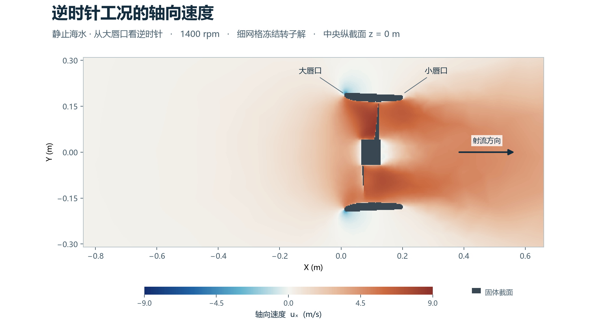

# 导管推进器逆时针静推计算

以细网格已收敛解为主结果，合推力 **2,475.4 N（252.4 kgf）**，方向为 −X。维持 1400 rpm 的水动力驱动轴矩为 **84.07 N·m**，对应轴功率 **12.33 kW**。

两个转子端面截面的平均轴向速度均为正。水从较大圆唇侧进入，从较小圆唇侧排出，推进器受力指向较大圆唇侧。

从较大圆唇端朝 +X 观察，转子逆时针旋转，角速度沿 −X。流体为静止海水，密度为 1025 kg/m³，动力黏度为 0.00108 Pa·s。小 X 端施加零表压总压，侧面和排水端按流入与流出平滑切换压力条件。采用 COMSOL 6.4 单相三维定常冻结转子计算和 k–ε 湍流壁面函数。导管固定，转子随内流域旋转。

## 轴向力与轴矩

力为水对固体的力，取 +X 为正。驱动轴矩是水对转子力矩的反作用，按绕 +X 轴的右手定则取正。

| 量 | 粗网格 | 细网格 | 两者差异 / 细网格绝对值 |
|---|---:|---:|---:|
| 转子轴向力（N） | -1,369.52 | -1,387.10 | 1.27% |
| 导管轴向力（N） | -990.60 | -1,088.27 | 8.98% |
| 合推力（N） | -2,360.12 | -2,475.37 | 4.66% |
| 合推力（kgf） | -240.66 | -252.42 | 4.66% |
| 驱动轴矩（N·m） | -94.56 | -84.07 | 12.48% |
| 水动力轴功率（kW） | +13.86 | +12.33 | 12.48% |

首次细网格求解末段的 11 个快照覆盖约第 298 至 395 次迭代。快照的合推力大小为 2,360–2,955 N，驱动轴矩大小为 79.8–95.9 N·m。这些区间描述稳态求解器的迭代波动。

续算第 12 次迭代至最终收敛时，推力大小从 2477.97 N 变为 2475.37 N，轴矩大小从 84.1165 N·m 变为 84.0690 N·m。以最终值为基准，两者分别变化 0.105% 和 0.057%。

## 求解与流量核对

粗网格含 236,249 个体单元。求解器用 89 次迭代达到相对容差 0.001，末次两个分离组的解误差估计为 0.0004, 0.00092。在 x = 0.055 和 0.140 m 处，截面平均轴向速度分别为 +5.623 和 +5.791 m/s。远场净质量流量 +0.077 kg/s，占首个截面质量通量绝对值的 0.016%，占远场进出流量绝对值之和的 0.00207%。

细网格含 519,843 个体单元。首次 400 次迭代未收敛。重启后求解器用 18 次迭代达到相对容差 0.0025，末次两个分离组的解误差估计为 0.001, 0.0016。在 x = 0.055 和 0.140 m 处，截面平均轴向速度分别为 +5.656 和 +5.838 m/s。远场净质量流量 +0.003 kg/s，占首个截面质量通量绝对值的 0.001%，占远场进出流量绝对值之和的 0.00007%。

主结果的远场轴向动量通量和压力反力之和为 -2,462.5 N，与壁面积分推力相差 0.52%。此控制体对照省略远场黏性应力。

## 适用范围

主结果对应的转子表面最低表压为 -84.8 kPa，其中 0.000% 的面积低于 −99 kPa 表压。实际浸深影响环境绝对压力，水温影响汽化压力，应结合这两项工况判断空化风险。

模型计算稳态水动力载荷。空化、自由液面、瞬态叶频脉动及电机与传动损耗均未建模。

[主结果 COMSOL 模型](V10f-CCWFine-1400rpm.mph) · [载荷积分记录](logs/CheckCCWFine.console) · [求解日志](logs/RestartCCW.log)

