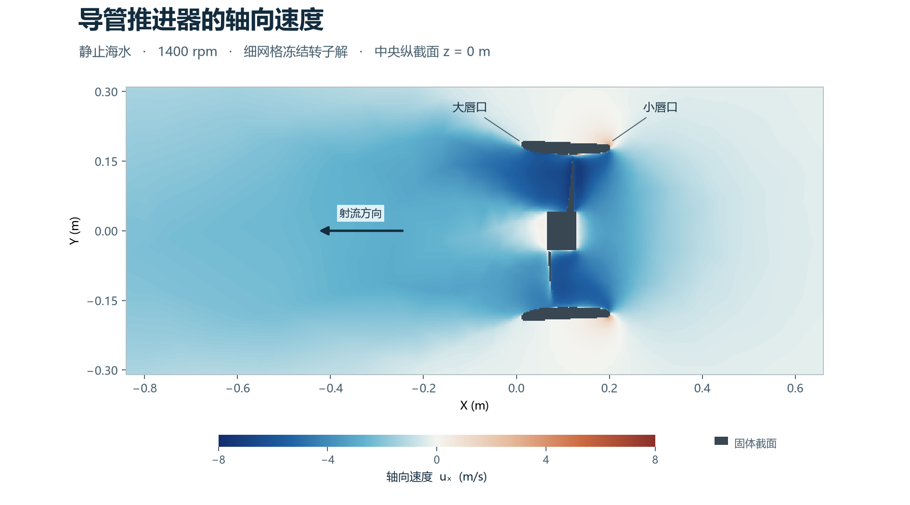

# 导管推进器静推力与驱动轴矩

细网格预测的合推力为 **1,262.4 N（128.7 kgf）**，方向为 +X。维持 1400 rpm 所需水动力驱动轴矩为 **55.11 N·m**，对应轴功率为 **8.08 kW**。

## 工况与方向

几何文件为 `3_320kgf_v10f.x_t`。从较大圆唇端朝 +X 观察，转子顺时针旋转，角速度沿 +X。采用静止海水系泊工况，密度 1025 kg/m³，动力黏度 0.00108 Pa·s。上游端施加零表压总压，侧面及排流端流入时采用零表压总压，流出时采用零表压静压，并在换向处平滑过渡。

COMSOL 6.4 使用三维、定常、单相不可压缩 RANS、k–ε 壁面函数和冻结转子。转子随内域旋转，导管固定。表中力为水作用在固体上的力。驱动轴矩为水对转子力矩的反作用，按绕全局 X 轴的右手定则记号。

## 网格与载荷

粗网格含 236,249 个四面体体单元。细网格含 519,843 个体单元，在转子和导管湿表面使用四层边界层网格。下表百分比为细网格与粗网格差值的绝对值除以细网格结果的绝对值。

| 量 | 粗网格 | 细网格 | 相对差异 |
|---|---:|---:|---:|
| 转子轴向力（N） | +704.84 | +679.77 | 3.69% |
| 导管轴向力（N） | +500.88 | +582.58 | 14.02% |
| 合推力（N） | +1,205.72 | +1,262.36 | 4.49% |
| 合推力（kgf） | +122.95 | +128.72 | 4.49% |
| 驱动轴矩（N·m） | +62.87 | +55.11 | 14.08% |
| 水动力轴功率（kW） | +9.22 | +8.08 | 14.08% |

| 细网格载荷分解 | 压力贡献 | 其余壁面应力贡献 | 合计 |
|---|---:|---:|---:|
| 转子轴向力（N） | +703.05 | -23.28 | +679.77 |
| 导管轴向力（N） | +588.67 | -6.09 | +582.58 |
| 驱动轴矩（N·m） | +47.65 | +7.45 | +55.11 |

## 流向与质量平衡

细网格两截面的面积平均轴向速度朝 −X，即较大圆唇侧。质量通量在截面上以 +X 为正，在远场以出流为正。

| 网格 | 截面 x（m） | 平均轴向速度（m/s） | 质量通量（kg/s） |
|---|---:|---:|---:|
| 粗 | 0.0550 | -4.744 | -403.253 |
| 粗 | 0.1400 | -4.923 | -418.560 |
| 细 | 0.0550 | -4.687 | -398.409 |
| 细 | 0.1400 | -4.894 | -416.035 |

| 网格 | 远场净流量（kg/s） | 远场进出流量绝对值之和（kg/s） | 不平衡 / 截面通量 | 不平衡 / 远场绝对通量 |
|---|---:|---:|---:|---:|
| 粗 | -3.37425 | 4340.48 | 0.8368% | 0.0777% |
| 细 | +1.19436 | 4257.11 | 0.2998% | 0.0281% |

截面归一化使用较小 x 截面的质量通量绝对值。

细网格远场轴向动量通量和压力反力之和为 +1,313.2 N，与壁面积分的合推力相差 4.03%。该对照省略远场黏性应力。

## 求解收敛与载荷稳定性

粗网格采用相对容差 0.001，共进行 55 次分离式迭代。细网格首次运行在第 183 次迭代中断。重启使用同一网格的恢复解作为初值，相对容差设为 0.0025，再经 5 次迭代收敛。末次两个分离组的解误差估计为 0.0011 和 0.0013。上表粗细网格差异包含网格设置和求解容差两方面的影响。

首次细网格运行在第 85 至 180 次迭代留存了 15 个快照。合推力范围为 1262.395–1262.482 N，驱动轴矩为 55.1164–55.1197 N·m。快照相对重启后最终解的最大差异分别为 0.010% 和 0.023%。

## 空化与适用范围

细网格最终解的转子表面最低表压为 -214.4 kPa，约 0.519% 的转子湿表面低于 −99 kPa 表压。若环境绝对压力约为一个大气压，局部压力提示浅水工况存在空化风险。实际浸深改变环境绝对压力，水温影响汽化压力，尚需这两项工况和空化计算判断载荷影响。

两套网格给出了离散差异，尚未开展三套网格的外推或水池试验对照。冻结转子计算给出指定转角的稳态预测。空化、自由液面、桨叶载荷脉动以及电机和传动损耗均未建模。

[细网格 COMSOL 模型](V10f-StaticFine-1400rpm.mph) · [首次细网格日志](logs/StaticFine.log) · [细网格重启日志](logs/RestartFine.log) · [细网格载荷与流量记录](logs/CheckStaticFine.console)

